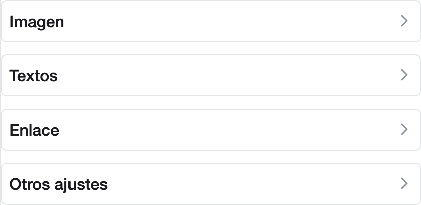
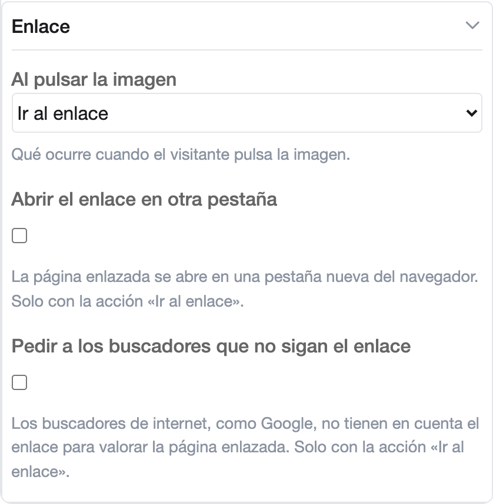

# Ver y cambiar las demás opciones de un bloque

Al seleccionar un bloque, el panel de la derecha muestra arriba solo las opciones que definen su contenido, como la
imagen, el título o el pie de foto. Las demás opciones están debajo, en grupos plegados. Para el uso normal de un
bloque puedes dejarlas como están. Si el bloque es nuevo, revisa los textos que trae su ejemplo en esos grupos, porque
cuentan como contenido de ejemplo al publicar
([Si la página conserva contenido del ejemplo](publish.md#si-la-pagina-conserva-contenido-del-ejemplo)).

## Abrir un grupo

1. Selecciona el bloque ([Seleccionar un bloque](select-block.md)).
2. Debajo de las opciones de contenido están los grupos, cada uno con su nombre y una flecha. En una **Imagen con
   pie**, por ejemplo, son **Imagen**, **Textos**, **Enlace** y **Otros ajustes**.

    { width="418" }

3. Pulsa el nombre del grupo. Se despliega con sus opciones y la ayuda de cada una.

    { width="419" }

4. Para plegarlo, vuelve a pulsar su nombre.

Cada vez que abres un bloque, sus grupos aparecen plegados, aunque tengan opciones cambiadas.

## Qué muestra cada tipo de bloque

Todos los tipos de bloque muestran arriba las opciones que definen su contenido y, debajo, sus grupos plegados. Los
que muestran una serie de imágenes o elementos, marcados con «Sí» en la tabla, los editan en la pestaña
**Elementos**, junto a **Opciones**.

| Bloque | Arriba | Grupos plegados | Pestaña **Elementos** |
|---|---|---|---|
| **Caja de búsqueda** | **Título**, **Subtítulo**, **Imagen de fondo** | **Textos**, **Búsqueda avanzada**, **Comportamiento**, **Filtros**, **Aspecto**, **Colocación**, **Resultados**, **Otros ajustes** | No |
| **Imagen con pie** | **Imagen**, **Título**, **Pie de foto**, **Enlace** | **Imagen**, **Textos**, **Enlace**, **Otros ajustes** | No |
| **Texto enriquecido** | **Texto**, **Título** | **Otros ajustes** | No |
| **Carrusel de cabecera** | **Título** | **Paso de las imágenes**, **Controles**, **Otros ajustes** | Sí |
| **Fondos y colecciones** | **Título**, **Enlace «Ver más»**, **Texto del enlace «Ver más»** | **Aspecto**, **Al pulsar una colección**, **Imágenes ampliadas**, **Otros ajustes** | Sí |
| **Galería ajustada** | **Título**, **Enlace «Ver más»**, **Texto del enlace «Ver más»** | **Aspecto**, **Imágenes y enlaces**, **Otros ajustes** | Sí |
| **Tira de imágenes de cabecera** | **Título** | **Aspecto**, **Controles**, **Paso de las imágenes**, **Otros ajustes** | Sí |
| **Carrusel de elementos** | **Título** | **Disposición**, **Controles**, **Paso de los elementos**, **Transición**, **Otros ajustes** | Sí |
| **Cuadrícula de elementos** | **Título** | **General**, **Elementos por fila**, **Qué se muestra**, **Otros ajustes** | Sí |
| **Mosaico de fotos** | **Título** | **Columnas**, **Qué se muestra**, **Otros ajustes** | Sí |
| **Vídeo** | **Plataforma**, **Código del vídeo**, **Código de la lista de reproducción**, **Título**, **Pie del vídeo** | **Vídeo**, **Textos**, **Aspecto**, **Reproducción**, **Otros ajustes** | No |

## Opciones que dependen de otra

Algunas opciones solo valen si otra tiene un valor concreto, y su ayuda lo dice. Por ejemplo, en un **Vídeo**,
**Reproducir al abrir la página**, **Sin sonido** y **Privacidad reforzada**, del grupo **Reproducción**, solo valen
con **Reproductor en la página** elegido en **Forma de mostrarlo**, del grupo **Aspecto**.

## Saber qué opciones has cambiado

La cabecera de cada grupo dice qué opciones suyas tienen un valor distinto del de partida, sin necesidad de abrirlo:

- Con hasta tres opciones cambiadas, las nombra. Por ejemplo: «Con cambios: Tiempo entre imágenes (milisegundos),
  Detener al pasar el ratón».

    { width="401" }

- Con más de tres, dice cuántas son, por ejemplo «Con 4 cambios». Para ver sus nombres, deja el ratón sobre ese
  texto.

Si vuelves a poner una opción en su valor de partida, desaparece de la cabecera.

Un bloque nuevo ya muestra «Con cambios» en los grupos en que su ejemplo trae un valor distinto del de partida. Por
ejemplo, en una **Caja de búsqueda** nueva, el grupo **Textos** dice «Con cambios: Texto dentro del campo vacío».

## Ejemplo: que las imágenes de un carrusel pasen más deprisa

En un **Carrusel de cabecera**, la opción **Tiempo entre imágenes (milisegundos)** está en el grupo **Paso de las
imágenes**. Con `3000`, la cabecera del grupo muestra «Con cambios: Tiempo entre imágenes (milisegundos)». En **Vista
previa**, cada imagen se ve 3 segundos antes de pasar a la siguiente.
