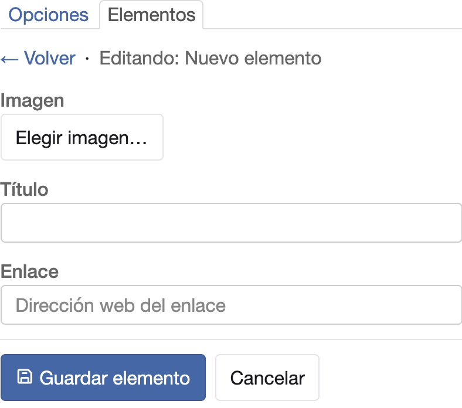
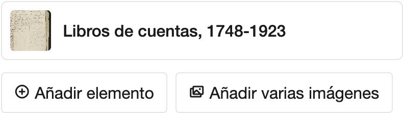

# Montar un carrusel de imágenes

El bloque **Carrusel de cabecera** muestra varias imágenes a todo el ancho de la página, una tras otra. Suele ir en la
cabecera.

Las imágenes se eligen, o se suben desde tu equipo, en el diálogo de cada elemento
([Elegir las imágenes de un bloque](choose-images.md)).

## Añadir el carrusel y sus imágenes

1. Abre la página en el editor ([Antes de empezar](index.md#antes-de-empezar)).
2. Pulsa **Añadir bloque** y elige **Carrusel de cabecera**. Sus opciones se abren a la derecha.
3. Pasa a la pestaña **Elementos** y pulsa **Añadir elemento**.

    { width="394" }

4. En **Imagen**, pulsa **Elegir imagen…** y elige la imagen en el diálogo
   ([cómo elegirla](choose-images.md#elegir-una-imagen)). La imagen es obligatoria.
5. Si quieres, escribe un **Título**. Se muestra como pie de la imagen. Es opcional: sin título, la imagen sale sin
   pie.
6. Si quieres que la imagen lleve a otra página, escribe su dirección en **Enlace**.
7. Pulsa **Guardar elemento**. El elemento aparece en la lista con su miniatura. Si no tiene título, la lista lo llama
   «Elemento 1 (sin título)», con su posición. Sin imagen, no se guarda y el mensaje te lo dice
   ([La imagen de un elemento es obligatoria](save-changes.md#la-imagen-de-un-elemento-es-obligatoria)).

    { width="395" }

8. Repite los pasos 3 a 7 con cada imagen. Con **Subir** y **Bajar** cambias su orden y con **Eliminar** la quitas.

Si ya tienes las imágenes en **Digitalizaciones** o en **Imágenes del portal**, puedes añadirlas todas de una vez: en
el paso 3, pulsa **Añadir varias imágenes** en lugar de **Añadir elemento** y marca las que quieras
([Elegir varias imágenes a la vez](choose-images.md#elegir-varias-imagenes-a-la-vez)). Cada una pasa a ser un elemento
guardado, sin título.

## Ajustar cómo se comporta

En la pestaña **Opciones**, arriba está el **Título**: el encabezado que se muestra sobre el carrusel. Sin título, no
se muestra ninguno.

Lo demás está en grupos plegados. Pulsa el nombre de un grupo para abrirlo
([Ver y cambiar las demás opciones de un bloque](block-options.md)).

| Grupo | Opción | Qué hace | Si no la cambias |
|---|---|---|---|
| **Paso de las imágenes** | **Pasar las imágenes solas** | Pasa de una imagen a la siguiente sin que el visitante haga nada. | Activada |
| **Paso de las imágenes** | **Tiempo entre imágenes (milisegundos)** | Tiempo que se ve cada imagen: 5000 son 5 segundos. El mínimo es 1000. | 5000 |
| **Paso de las imágenes** | **Detener al pasar el ratón** | Detiene el paso de las imágenes mientras el ratón está sobre el carrusel. | Activada |
| **Controles** | **Mostrar puntos de posición** | Muestra un punto por imagen para saltar a cualquiera. | Activada |
| **Controles** | **Mostrar flechas** | Muestra las flechas de anterior y siguiente. | Activada |

Con una sola imagen, el carrusel no pasa de imagen ni muestra flechas ni puntos, aunque estén activados.

## Cambiar la altura

Todas las imágenes del carrusel tienen la misma altura: 400 píxeles si no la cambias. Las que no tienen esa
proporción se recortan para llenar el espacio.

Para cambiarlo:

1. En **Opciones**, pulsa el grupo **Otros ajustes**.
2. En **Estilo personalizado**, pulsa **Añadir ajuste**. Escribe `slideHeight` en **Ajuste** y la altura en **Valor
   del ajuste**, por ejemplo `300px`.
3. Si prefieres ver cada imagen entera, sin recortes, pulsa otra vez **Añadir ajuste** y escribe `imgObjectFit` en
   **Ajuste** y `contain` en **Valor del ajuste**. Con `cover`, el valor por defecto, la imagen llena el espacio y se
   recorta.

Para quitar un ajuste, pulsa el botón a la derecha de su fila. Al dejar el ratón sobre él, dice **Quitar este
ajuste**.

## Comprobar el resultado

1. Pulsa **Vista previa**. El carrusel pasa de una imagen a otra con el tiempo elegido.
2. Cuando esté a tu gusto, pulsa **Publicar**.
