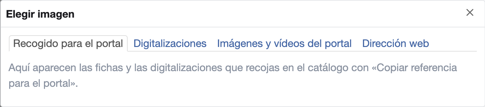
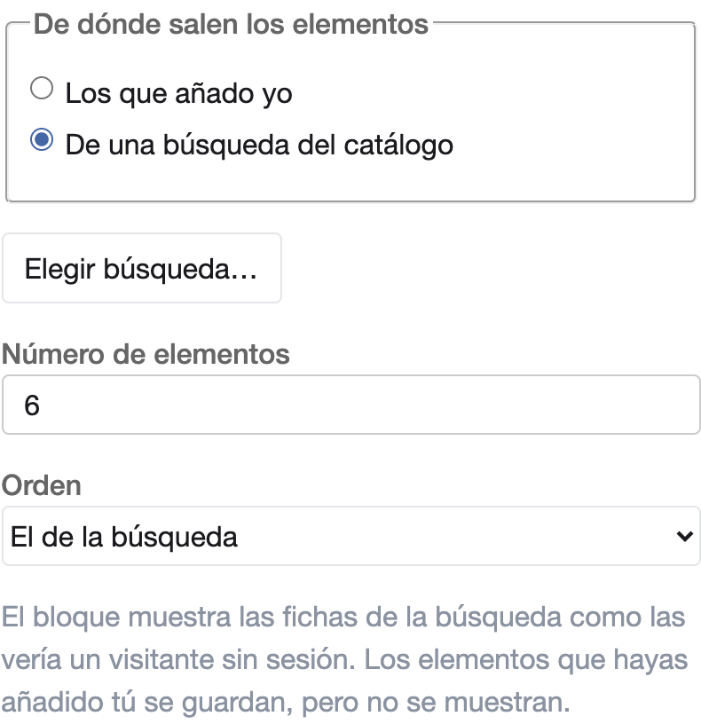

# Elegir contenido del catálogo

Una ficha, una búsqueda o un nivel del cuadro de clasificación se pueden poner en una página del portal sin escribir
ninguna dirección. Se recogen en el catálogo y se eligen después desde el editor.

## Recoger en el catálogo

La acción **Copiar referencia para el portal** la ven las cuentas con permiso de administración del portal. Está en:

- la ficha de una descripción;
- el visor de un adjunto, que recoge la digitalización;
- las filas de los resultados que tienen signatura;
- cada nivel del **Cuadro de fondos**.

Para recoger una búsqueda entera, abre **Más acciones** en la página de resultados y pulsa **Copiar
búsqueda para el portal**.

Al pulsar, la acción cambia su texto a «Copiada y recogida para el portal». Además de copiar la referencia, la deja en tu
lista de lo recogido, que el editor ofrece al elegir contenido. Una digitalización se recoge también desde **Gestión de
digitalizaciones** ([Qué se guarda en el campo](choose-images.md#que-se-guarda-en-el-campo)).

## Elegirlo en el editor

En el diálogo de una imagen o de un enlace, la primera pestaña es **Recogido para el portal**. Sin nada recogido,
dice «Aquí aparecen las fichas y las digitalizaciones que recojas en el catálogo con «Copiar referencia para el
portal».».

{ width="739" }

Lo último que recoges sale arriba. Una ficha, una búsqueda o un nivel se nombra por su tipo y su título, por ejemplo
«Ficha: Plano de la acequia de San Esteban de Litera», y una digitalización por el nombre de su fichero. Cada entrada
tiene dos botones:

- **Elegir** la pone en el campo.
- **Quitar de lo recogido** la saca de la lista, sin pedir confirmación. No borra nada del catálogo.

Un campo de imagen ofrece las fichas y las digitalizaciones. Una ficha que tiene imagen sale con ella, y el campo la
muestra con su miniatura, el título de la ficha y su tamaño. Un campo de enlace ofrece las fichas, las búsquedas y los
niveles del cuadro; las búsquedas y los niveles no llevan miniatura y el hueco queda vacío.

El diálogo **Elegir imágenes**, el de **Añadir varias imágenes**, también tiene esta pestaña. Allí cada ficha y cada
digitalización lleva una casilla en lugar de **Elegir**, y se pulsa **Añadir las marcadas**.

El enlace se explica en [Elegir un enlace](choose-images.md#elegir-un-enlace).

## Un bloque con una búsqueda

Los bloques con elementos, como el **Carrusel de cabecera**, pueden tomarlos de una búsqueda en lugar de escribirlos
uno a uno.

1. Selecciona el bloque y pasa a la pestaña **Elementos**.
2. En **De dónde salen los elementos**, elige **De una búsqueda del catálogo**.
3. Pulsa **Elegir búsqueda…**. El diálogo **Elegir búsqueda** lista las búsquedas que has recogido.

    { width="395" }

Con la búsqueda elegida, el bloque muestra su nombre, por ejemplo «Búsqueda: Cualquier término contiene archivo», con
**Cambiar** y **Quitar**. **Quitar** devuelve el bloque a **Los que añado yo**, con los elementos que ya tenía.

**Número de elementos** admite de 1 a 30. **Orden** ofrece **El de la búsqueda**, **Título**, **Fecha, de la más
antigua a la más reciente**, **Fecha, de la más reciente a la más antigua** y **Signatura**.

El bloque enseña las fichas que vería un visitante sin sesión del sitio público, también en **Vista previa**. Los
elementos que habías añadido a mano se conservan, pero no se muestran.

Si ese visitante no vería ninguna ficha, debajo sale el aviso «Un visitante sin sesión no vería ninguna ficha de esta
búsqueda, así que el bloque saldrá vacío.».
