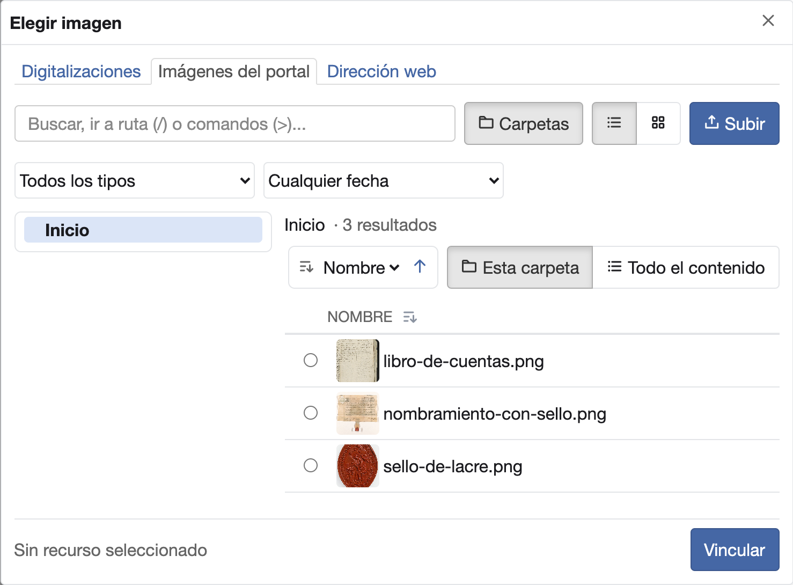
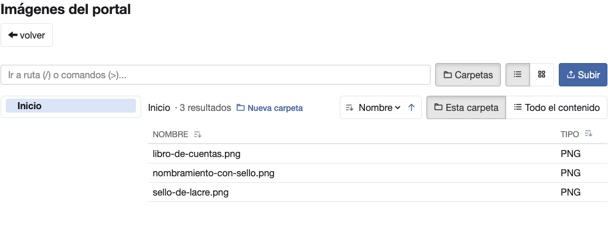
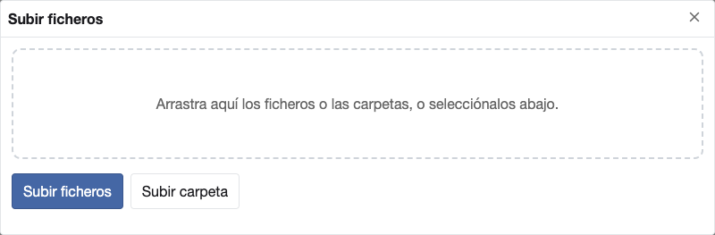

# Elegir las imágenes de un bloque

Cada campo de imagen de un bloque, como **Imagen** o **Imagen de fondo**, se rellena desde el diálogo **Elegir
imagen**. El diálogo tiene una pestaña por origen de la imagen:

- **Digitalizaciones**: las copias digitales asociadas a las descripciones del archivo.
- **Imágenes del portal**: un espacio aparte para el material propio de la web, como cabeceras, logotipos o
  adaptaciones de una imagen para la difusión.
- **Dirección web**: la dirección de una imagen publicada en otro sitio.

Tú decides dónde guardas cada imagen. Un consejo: lo que preparas solo para el portal, como un recorte o una versión
retocada, va mejor en **Imágenes del portal**, para no mezclarlo con los originales del archivo.

## Elegir una imagen

1. En las opciones del bloque, busca el campo de imagen. Si está vacío, muestra el botón **Elegir imagen…**.
2. Pulsa **Elegir imagen…**. Se abre el diálogo **Elegir imagen**.
3. Pulsa la pestaña del origen: **Digitalizaciones** o **Imágenes del portal**. La pestaña muestra sus carpetas a la
   izquierda y su contenido a la derecha.

    { width="739" }

4. Entra en la carpeta de la imagen. Con **Vista de lista** ves cada imagen en miniatura junto a su nombre; con
   **Vista de mosaico**, más grande.
5. Marca el botón redondo de la imagen. Abajo aparece «Seleccionado:» con su nombre.
6. Pulsa **Vincular**. El diálogo se cierra y el campo muestra la imagen en miniatura.

Si pulsas el nombre de una imagen, se abre en grande. Desde ahí, **Vincular este** la elige directamente.

En las opciones de un bloque, el cambio se guarda solo, como cualquier otro. En el formulario de un elemento, se guarda
al pulsar **Guardar elemento** ([Guardar un elemento](save-changes.md#guardar-un-elemento)).

Con el campo vacío, el diálogo se abre en la última pestaña que usaste mientras dura tu sesión. Con una imagen ya
elegida, se abre en la pestaña de su origen.

## Elegir varias imágenes a la vez

En los bloques cuyos elementos llevan imagen, puedes elegir varias imágenes de una vez y cada una se convierte en un
elemento. Son el **Carrusel de cabecera**, la **Tira de imágenes de cabecera**, el **Carrusel de elementos**, la
**Cuadrícula de elementos**, el **Mosaico de fotos**, la **Galería ajustada** y **Fondos y colecciones**.

1. Selecciona el bloque y pasa a la pestaña **Elementos**.
2. Pulsa **Añadir varias imágenes**. Se abre el diálogo **Elegir imágenes**, con las pestañas **Digitalizaciones** e
   **Imágenes del portal**. La pestaña **Dirección web** no sale aquí: cada dirección se escribe en su elemento.
3. Entra en la carpeta y marca la casilla de cada imagen, en el orden en que quieres verlas. Abajo aparece
   «Seleccionados» con el número de imágenes marcadas y sus nombres.
4. Pulsa **Vincular**, que lleva entre paréntesis cuántas has marcado, por ejemplo **Vincular (3)**.

El diálogo se cierra y las imágenes se añaden al final de la lista, en el orden en que las marcaste, sin título. El
título o el enlace de una de ellas se añade en su elemento, como en cualquier otro
([Guardar un elemento](save-changes.md#guardar-un-elemento)).

Para añadir una sola imagen sigue valiendo **Añadir elemento**, y también para usar una dirección web.

### Si al bloque le falta algo más que la imagen

Algunos bloques piden en cada elemento algo más que la imagen. Por ejemplo, cada imagen de una **Galería ajustada**
necesita su **Enlace**. Entonces las imágenes elegidas no se guardan todavía:

- Sale el aviso «A 3 imágenes elegidas les faltan datos: complétalos y guarda cada una. Hasta entonces no se muestran
  en la página.».
- En la lista, cada una sale con su miniatura y lo que le falta, por ejemplo «Sin guardar: falta «Enlace»».
- El editor abre la primera con ese campo marcado. Al guardarla con **Guardar elemento**, se abre la siguiente.

Hasta que las guardas, no llegan a la página ni a la vista previa. Si pasas a otro bloque o a la pestaña **Opciones**,
siguen en la lista al volver. También siguen si mueves el bloque, editas un texto sobre la página en la vista **Visual**
o guardas cambios en **Editar YAML**. Para completar más tarde una de ellas, pulsa su fila en la lista. Si no la quieres, pulsa
**Eliminar** en su fila.

Si publicas con imágenes pendientes, no se publican, y un aviso lo dice tras el de éxito
([Publicar](publish.md#publicar)).

## Cambiar o quitar la imagen

Con una imagen elegida, el campo muestra dos botones:

- **Cambiar** abre el diálogo para elegir otra.
- **Quitar** deja el campo vacío.

Una imagen del ejemplo que trae un bloque nuevo se muestra en el campo como cualquier otra: con su miniatura, su
nombre y su tamaño. Al pulsar **Cambiar**, el diálogo se abre como en un campo vacío, sin ninguna imagen seleccionada.
Elige la tuya ([Elegir una imagen](#elegir-una-imagen)).

Si el bloque necesita la imagen, al quitarla no se guarda y sale un mensaje que te pide revisar el campo
([Cuando un cambio no se guarda](save-changes.md#cuando-un-cambio-no-se-guarda)).

## Ver el nombre y el tamaño de la imagen

Bajo la miniatura, el campo muestra el nombre del fichero y su tamaño en píxeles, ancho por alto, por ejemplo
«640 × 300 píxeles».

Si la imagen es más estrecha de lo que el bloque necesita para que se vea nítida, sale debajo un aviso como «Es más
estrecha de lo que necesita el bloque (1140 píxeles de ancho) y puede verse borrosa.». El aviso no impide guardar:
puedes quedarte con esa imagen o elegir otra más ancha.

Si la imagen no se puede cargar, por ejemplo una dirección web que ya no existe, solo sale su nombre.

El ancho a partir del cual avisa cada bloque es este:

| Bloque | Campo | Ancho |
|---|---|---|
| **Carrusel de cabecera**, **Carrusel de elementos** | **Imagen** del elemento | 1140 |
| **Imagen con pie** | **Imagen** | 1140 |
| **Caja de búsqueda** | **Imagen de fondo** | 1140 |
| **Tira de imágenes de cabecera** | **Imagen** del elemento | 450 |
| **Galería ajustada** | **Imagen** del elemento | 360 |
| **Mosaico de fotos** | **Imagen** del elemento | 280 |
| **Cuadrícula de elementos** | **Imagen** del elemento | 270 |
| **Fondos y colecciones** | **Portada** | 380 |
| **Fondos y colecciones** | **Imagen redonda** | 140 |
| **Fondos y colecciones** | **Fichero** de cada imagen ampliada | 1080 |

## Subir una imagen desde el diálogo

Las pestañas **Imágenes del portal** y **Digitalizaciones** permiten subir imágenes de tu equipo sin salir del
editor. Si tu instalación no permite añadir digitalizaciones desde el portal, la pestaña **Digitalizaciones** no
ofrece subir.

1. En el diálogo, pulsa la pestaña y entra en la carpeta donde quieres guardar la imagen.
2. Pulsa **Subir**. Aparece la zona «Arrastra aquí los ficheros o las carpetas, o selecciónalos abajo.».
3. Pulsa **Subir ficheros** y elige una imagen, o arrástrala a esa zona.
4. La imagen se guarda en la carpeta en que estás y queda elegida: el diálogo se cierra y el campo la muestra.

Si la arrastras sobre una carpeta de la lista, se guarda en esa carpeta.

Cada vez se sube una sola imagen o una carpeta. Si subes varias imágenes sueltas a la vez, con **Subir ficheros** o
arrastrándolas, no se guarda ninguna y la pestaña lo dice con el nombre de cada una. Las imágenes que ya están subidas
sí se pueden elegir varias a la vez ([Elegir varias imágenes a la vez](#elegir-varias-imagenes-a-la-vez)).

Solo se admiten imágenes en formato jpg, jpeg, png, webp o gif. Con otro fichero, la pestaña lo dice, por ejemplo «documento.txt: extensión no permitida (permitidas: jpg, jpeg, png, webp, gif).», y
no se guarda.

Si en la carpeta ya hay una imagen con el mismo nombre, la nueva no la sustituye. La pestaña lo avisa, por ejemplo
«Ya hay un fichero llamado «escudo.png» en la carpeta. Elígelo en la lista o cámbiale el nombre y vuelve a
subirlo.».

### Subir una carpeta entera

1. Pulsa **Subir** y después **Subir carpeta**, y elige una carpeta de tu equipo.
2. Sus imágenes se guardan en una carpeta con el mismo nombre, dentro de la carpeta en que estás.
3. No se elige ninguna: el campo no cambia y la lista muestra la carpeta nueva. Entra en ella y elige la imagen.

Los avisos de cada fichero que no se ha guardado siguen a la vista hasta que termina la subida.

## Usar una dirección web

En el diálogo, pulsa la pestaña **Dirección web**. La dirección de la imagen va en **Dirección web de la imagen**.
Con **Usar esta dirección**, el diálogo se cierra y el campo muestra la imagen.

Una imagen de otra web se ve mientras esa web la mantenga en la misma dirección. Si la cambia o la borra, deja de
verse en tu página. Por eso es mejor guardar las imágenes en **Imágenes del portal** o en **Digitalizaciones**.

## Qué se guarda en el campo

Al elegir una imagen de **Digitalizaciones** o de **Imágenes del portal**, el campo guarda una referencia a esa
imagen, por ejemplo `media://escudo.png` o `digitization://fondo/vista-plaza.jpg`. No se copia nada: la página usa
la imagen del almacén.

La referencia solo la entiende el portal. No es una dirección para abrir en el navegador ni para compartir fuera de
él.

Una digitalización se puede elegir también escribiendo su referencia:

1. Pulsa **Administración** en el menú superior y, después, **Gestión de digitalizaciones**.
2. En la fila de la digitalización, pulsa **Más acciones** y después **Copiar referencia para el portal**. Sale el
   aviso «Referencia copiada». La acción la ven las cuentas con permiso de administración del portal.
3. En el editor, abre el diálogo de la imagen y pulsa la pestaña **Dirección web**. La referencia se usa como una
   dirección web ([Usar una dirección web](#usar-una-direccion-web)).

La próxima vez que abras el diálogo de ese campo, se abre en la pestaña **Digitalizaciones**.

## Enlazar a una descripción del archivo

Un campo de enlace, como **Enlace**, no tiene diálogo: admite solo una dirección, que escribes en el campo. Para que
lleve a una descripción del archivo, usa su referencia:

1. Busca la descripción con **Búsqueda**, en el menú superior.
2. En su fila de resultados o en su ficha, pulsa **Copiar referencia para el portal**.

La referencia copiada, por ejemplo `opac://item/E783`, es la dirección que admite el campo de enlace. En la página
publicada, el enlace lleva a la ficha de esa descripción.

## Subir imágenes desde la administración

Las imágenes del portal también se suben y se organizan fuera del editor:

1. Pulsa **Administración** en el menú superior y, en el apartado **General**, pulsa **Imágenes del portal**.

    { width="638" }

2. Pulsa **Subir**. En la ventana **Subir ficheros**, pulsa **Subir ficheros** y elige las imágenes de tu equipo, o
   pulsa **Subir carpeta** y elige una carpeta.

    { width="739" }

3. Las imágenes aparecen en la lista. Las de una carpeta, en una carpeta con su nombre.

## Ver las imágenes en la lista de elementos

En los bloques con varios elementos, como el [carrusel](carousel.md), la pestaña **Elementos** lista los elementos con
la miniatura de su imagen. Un elemento sin título se muestra como «Elemento» seguido de su posición y «(sin
título)», por ejemplo «Elemento 2 (sin título)». Un elemento que aún no se ha guardado lleva al lado lo que le falta,
por ejemplo «Sin guardar: falta «Enlace»» ([Si al bloque le falta algo más que la
imagen](#si-al-bloque-le-falta-algo-mas-que-la-imagen)).
