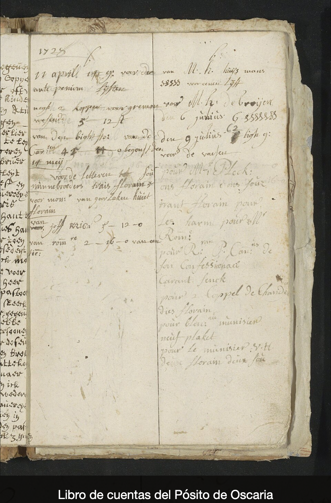

# Ampliar una imagen al hacer clic

El bloque **Imagen con pie** muestra una imagen con un texto debajo. Puedes hacer que, al pulsarla, el visitante la
vea ampliada sobre la página, con el mismo pie.

En **Fondos y colecciones**, cada colección puede llevar su propia serie de imágenes ampliadas, que el visitante
recorre al pulsar la portada ([Ampliar las imágenes de una colección](#ampliar-las-imagenes-de-una-coleccion)).

## Configurar la ampliación

1. Abre la página en el editor ([Antes de empezar](index.md#antes-de-empezar)).
2. Pulsa **Añadir bloque** y elige **Imagen con pie**, o pulsa un bloque **Imagen con pie** que ya tengas.
3. En **Imagen**, pulsa **Elegir imagen…** y elige la imagen en el diálogo
   ([cómo elegirla](choose-images.md#elegir-una-imagen)).
4. En **Pie de foto**, escribe el texto que irá debajo de la imagen, de 1 a 180 caracteres, y sal del campo.

    La imagen y el pie de foto son obligatorios. En un bloque nuevo, al rellenar el primero sale el aviso de que el
    bloque no se ha guardado y de que revises el otro. Cuando los dos tienen valor, el bloque se guarda con los dos
    ([Guardar los cambios](save-changes.md)).

5. Pulsa el grupo **Enlace** para abrirlo ([Ver y cambiar las demás opciones de un bloque](block-options.md)).
6. En **Al pulsar la imagen**, elige **Ampliarla en la misma página**. Con esta opción no hace falta rellenar
   **Enlace**.

Las otras opciones de **Al pulsar la imagen** son:

- **Ir al enlace**, la que tiene un bloque nuevo: la imagen lleva a otra dirección. Escribe la dirección en
  **Enlace**, arriba en el panel.
- **Nada**: la imagen no responde al clic.

## Comprobar el resultado

1. Pulsa **Vista previa** y, en la pestaña que se abre, pulsa la imagen.
2. La imagen se abre ampliada sobre la página, con el pie de foto debajo.

    

3. Para cerrarla, pulsa **Cerrar**, pulsa la tecla Esc o haz clic fuera de la imagen.
4. Cuando esté a tu gusto, vuelve al editor y pulsa **Publicar**.

## Ampliar las imágenes de una colección

En el bloque **Fondos y colecciones**, cada colección es un elemento con su **Portada**. Las imágenes que se ven al
pulsarla se eligen en el formulario del elemento, en **Imágenes ampliadas**.

### Elegir las imágenes ampliadas

1. Selecciona el bloque **Fondos y colecciones** y pasa a la pestaña **Elementos**.
2. Pulsa la colección en la lista, o pulsa **Añadir elemento** para crear una.
3. En **Imágenes ampliadas**, pulsa **Añadir varias imágenes** y marca en el diálogo las imágenes de la colección, en
   el orden en que quieres que se vean ([Elegir varias imágenes a la vez](choose-images.md#elegir-varias-imagenes-a-la-vez)).
   Se añaden al final de la lista, cada una con su formulario.
4. En el formulario de cada imagen puedes escribir su **Título**, que sale como pie de la imagen ampliada, y su
   **Enlace a la ficha**, por ejemplo la referencia de su descripción en el archivo
   ([Enlazar a una descripción del archivo](choose-images.md#enlazar-a-una-descripcion-del-archivo)).
5. Pulsa **Guardar elemento**.

Para añadir una sola imagen, pulsa **Añadir imagen** y, en su **Fichero**, **Elegir imagen…**. Con **Eliminar
imagen** quitas una de la lista.

### Que la portada abra las imágenes

1. Pasa a la pestaña **Opciones** y pulsa el grupo **Al pulsar una colección**.
2. En **Al pulsar una colección**, elige **Ver sus imágenes ampliadas**.

Con esta opción, cada colección del bloque necesita al menos una imagen ampliada. Si a alguna le faltan, la opción se
guarda igual y sale un mensaje que nombra la primera, por ejemplo «Se ha guardado. Falta «Imágenes ampliadas» en el
elemento 2 de «Fondos y colecciones»: complétalo.». El editor abre esa colección con **Imágenes ampliadas** marcado.
Elige sus imágenes y pulsa **Guardar elemento**. Si falta en otra colección, el mensaje la nombra y el editor la abre.
Por eso conviene elegir antes las imágenes de todas las colecciones.

El grupo **Imágenes ampliadas** de **Opciones** ajusta cómo se ven: dónde va el pie, el número de imagen, la tira de
miniaturas o el texto del enlace a la ficha ([Ver y cambiar las demás opciones de un bloque](block-options.md)).

### Comprobar las imágenes de una colección

1. Pulsa **Vista previa** y, en la pestaña que se abre, pulsa la portada de una colección.
2. Se abre su primera imagen ampliada sobre la página, con el nombre de la colección y el título de la imagen, el
   número de imagen, por ejemplo «Imagen 1 de 2», y una tira con las miniaturas de todas.
3. Pasa de una a otra con las flechas o pulsando una miniatura. Si la imagen tiene **Enlace a la ficha**, sale
   **Ver ficha**, que lleva a esa ficha.
4. Para cerrarla, pulsa el aspa de arriba a la derecha o la tecla Esc.
