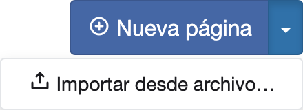
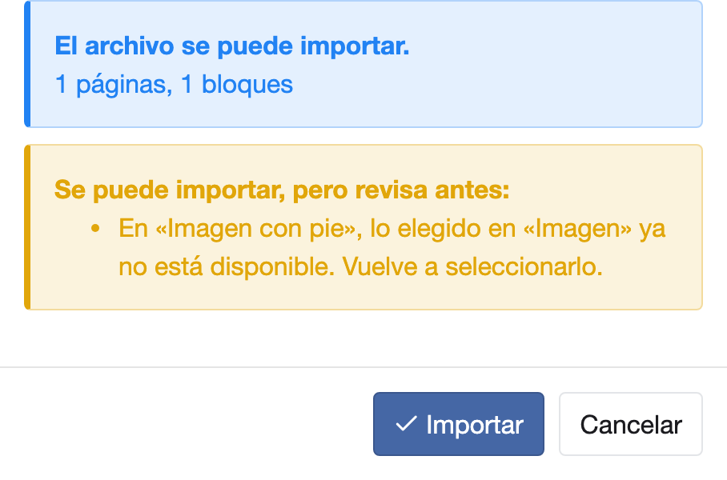

# Importar una página

Una página guardada en un fichero YAML se añade al portal sin volver a montarla. Antes de importarla, la aplicación
revisa el fichero y dice qué le falta, con el bloque y el campo.

## Importar el fichero

1. En la lista de **Páginas** ([Antes de empezar](index.md#antes-de-empezar)), despliega el menú de al lado de **Nueva
   página** y pulsa **Importar desde archivo…**.

    { width="220" }

2. Elige el fichero, de 1 MB como mucho y con la extensión `.yml` o `.yaml`, y pulsa **Revisar el archivo**.
3. Lee lo que dice la revisión. Si el fichero se puede importar, pulsa **Importar**.

    { width="454" }

La página importada es un borrador. Los visitantes no la ven hasta que la publicas
([Publicar una página](publish.md)).

El nombre del fichero dice a qué página corresponde. Si ya hay una página con ese nombre, el fichero pasa a ser su
edición, y los visitantes siguen viendo la versión publicada. Si esa página tiene cambios sin publicar, antes de
sustituirlos se muestran las diferencias. **Sustituir mis cambios** los pierde.

## Entender lo que dice la revisión

«El archivo se puede importar.» sale si el fichero no tiene errores. Si además sale «Se puede importar, pero revisa
antes:», la lista dice qué queda por arreglar en la página. Puedes importarla y arreglarlo después en el editor. Por
ejemplo:

- Una imagen del fichero no está en **Imágenes y vídeos del portal**: «En «Imagen con pie», lo elegido en «Imagen» ya no
  está disponible. Vuelve a seleccionarlo.». También puedes subir antes la imagen, en la misma carpeta y con el mismo
  nombre que en el fichero ([Elegir imágenes](choose-images.md)).
- Falta un dato obligatorio: «En «Imagen con pie», falta «Pie de foto». Complétalo.».

«El archivo no se puede importar.» sale si el fichero tiene un error, y entonces **Importar** no se puede pulsar. La
lista dice qué corregir en el fichero. Por ejemplo:

- No está bien escrito: «El archivo no es un YAML correcto: revisa la línea 12, columna 3.».
- Un bloque es de un tipo que este portal no tiene: ««Mapa» es de un tipo que no existe en este portal. Cambia el
  tipo o quita el bloque.».

Corrígelo, pulsa **Cambiar archivo** y vuelve a elegirlo.

Los mismos avisos salen al validar o guardar en **Editar YAML**, en el menú **Más acciones** del editor.
