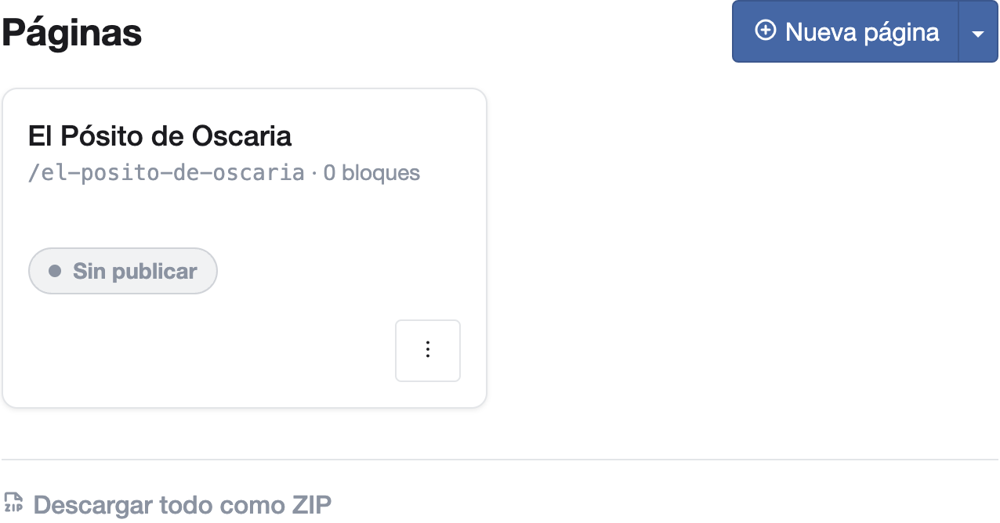
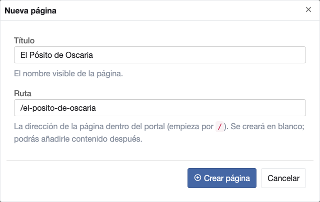
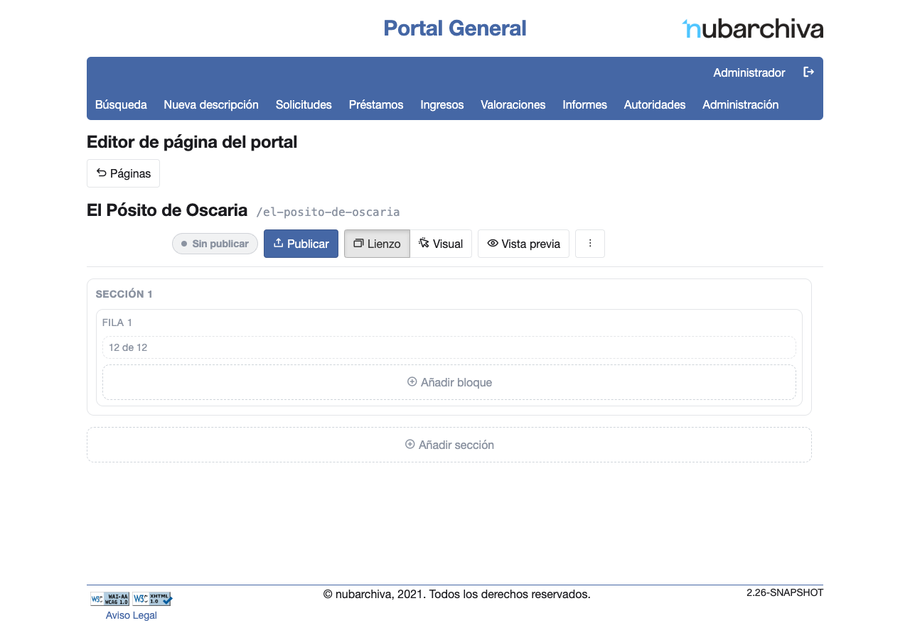
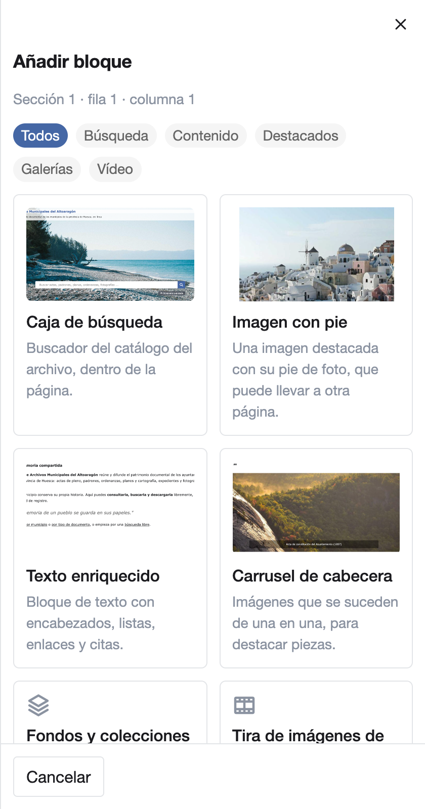

# Portal de difusión

El portal de difusión es la web pública de tu archivo. Sus páginas se montan con bloques en el editor de páginas, sin
escribir código. Esta sección explica, tarea a tarea, cómo hacerlo.

## Tareas

- [Seleccionar un bloque](select-block.md)
- [Ver y cambiar las demás opciones de un bloque](block-options.md)
- [Guardar los cambios y entender sus avisos](save-changes.md)
- [Publicar una página y ver cómo la ve un visitante](publish.md)
- [Montar un carrusel de imágenes](carousel.md)
- [Configurar la caja de búsqueda](search-box.md)
- [Ampliar una imagen al hacer clic](image-zoom.md)
- [Elegir las imágenes de un bloque](choose-images.md)

## Antes de empezar

Para editar el portal necesitas una cuenta con permiso de administración del portal.

1. Entra en nubarchiva y pulsa **Administración** en el menú superior.
2. En el apartado **General**, pulsa **Portal de Difusión**. Se abre la lista de **Páginas**.

    

3. Para crear una página, pulsa **Nueva página**, escribe su **Título** y pulsa **Crear página**. La **Ruta** se
   propone a partir del título.

    

4. Pulsa el título de una página para abrir el **Editor de página del portal**.

    

## Cómo funciona el editor

- **Añadir un bloque**: pulsa **Añadir bloque** y elige el tipo en el catálogo. Sus opciones se abren en el panel de
  la derecha: arriba, las que definen su contenido; debajo, las demás, en grupos plegados
  ([Ver y cambiar las demás opciones de un bloque](block-options.md)).

    

- **Cambiar un bloque**: pulsa en cualquier punto del bloque para volver a abrir sus opciones
  ([Seleccionar un bloque](select-block.md)).
- **Guardar**: no hay botón de guardar. Cada cambio se guarda solo. Al cambiar las opciones de un bloque, el aviso
  «Guardado» lo confirma y, si algo no se ha guardado, un mensaje te dice qué campo revisar
  ([Guardar los cambios](save-changes.md)).
- **Ver cómo queda**: pulsa **Vista previa**. Se abre en otra pestaña la página con tus cambios, con la cabecera y el
  pie de la web pública, y puedes verla con el ancho de un móvil, una tableta o un escritorio
  ([Ver la página en cada dispositivo](publish.md#ver-la-pagina-en-cada-dispositivo)). Si haces más cambios, recarga
  esa pestaña.
- **Publicar**: los visitantes no ven nada hasta que pulsas **Publicar**. Entonces aparece el aviso «¡Publicado! Los
  visitantes ya ven tus cambios.». La dirección pública de la página se copia desde **Más acciones**
  ([Publicar una página](publish.md)).

!!! tip "Prueba los clics en la vista previa"
    En el lienzo del editor, un clic sobre un bloque lo selecciona para editarlo. Lo que hace un clic del visitante,
    como abrir una imagen ampliada, se prueba en **Vista previa**.
