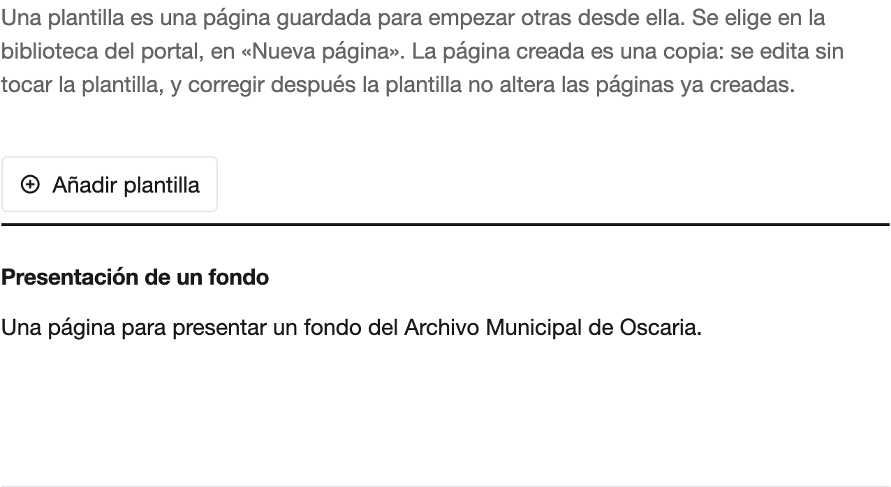
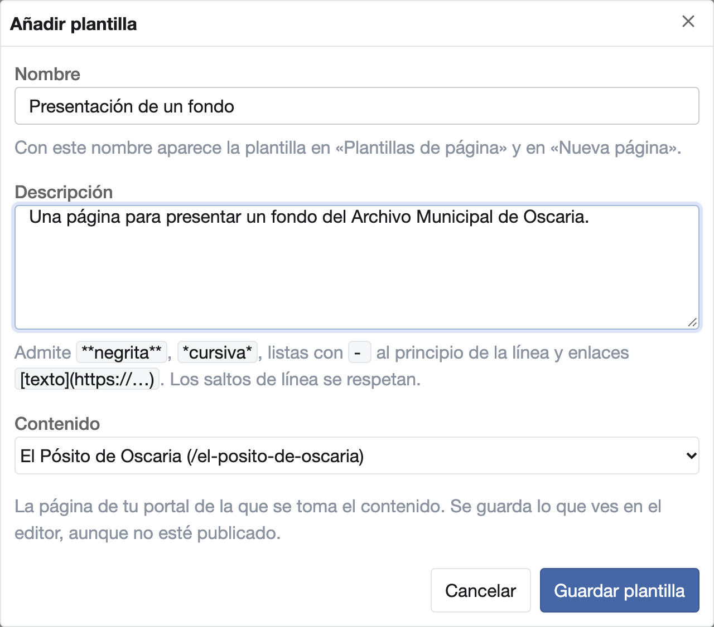
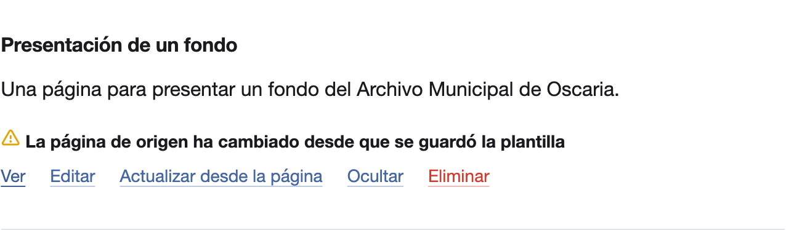

# Mantener las plantillas de página

Las plantillas se mantienen en **Plantillas de página**: se añaden, se ponen al día cuando cambia la página de la que
salen, se ocultan y se eliminan. Se usan al crear una página ([Empezar desde una plantilla](templates.md)).

## Añadir una plantilla

En **Administración**, apartado **Portal de difusión**, pulsa **Plantillas de página**.

{ width="638" }

1. Pulsa **Añadir plantilla**.
2. En **Contenido**, elige la página de tu portal de la que se toma el contenido. Se guarda lo que ves en el editor,
   aunque no esté publicado.
3. Pulsa **Guardar plantilla**.

    { width="640" }

El **Nombre** es obligatorio y puede repetirse. Con él aparece la plantilla en **Plantillas de página** y en **Nueva
página**. La **Descripción** admite negrita, cursiva, listas y enlaces.

También se guarda una página como plantilla desde su editor: en **Más acciones**, pulsa **Guardar como
plantilla…**. El **Nombre** se propone con el título de la página. Al guardar sale el aviso «Se ha guardado la plantilla
«…».».

Las acciones de cada plantilla salen al pasar el ratón por ella o al llegar con Tab. **Ver** la abre en otra pestaña,
como se vería al crear una página desde ella.

## Saber si la página de una plantilla ha cambiado

La plantilla recuerda la página de la que tomó su contenido, pero no la sigue. Si esa página cambia después,
**Plantillas de página** avisa: «La página de origen ha cambiado desde que se guardó la plantilla». Si la página ya no
existe, el aviso es «La página de origen ya no existe».

{ width="638" }

Para poner la plantilla al día, pulsa **Actualizar desde la página**. Toma el contenido actual de la página y conserva
el **Nombre** y la **Descripción**. Desde el editor de esa página se hace igual: en **Más acciones**, pulsa **Actualizar
la plantilla «…»**.

En la lista de **Páginas**, la página de la que sale una plantilla lleva la marca **Origen de plantilla**. Al dejar el
ratón sobre la marca se lee «Se guardó como plantilla «…»».

Una plantilla sin página de origen no avisa hasta que vuelve a tomar el contenido de una página.

## Corregir una plantilla

La plantilla no se edita en el editor de páginas, que trabaja con páginas: corrige la página de la que sale y pulsa
**Actualizar desde la página**. Si la plantilla no tiene página de origen o esa página ya no existe, crea una página
desde ella y corrígela. Después pulsa **Editar** en la plantilla, elige esa página en **Contenido** y pulsa **Guardar
plantilla**.

Con **Contenido** vacío se conserva el contenido actual y solo cambian el **Nombre** y la **Descripción**.

## Ocultar y eliminar una plantilla

- **Ocultar** retira la plantilla de **Nueva página**. En **Plantillas de página** sigue visible con la marca
  **Oculta**, y **Mostrar** la devuelve a **Nueva página**.
- **Eliminar** pide confirmación: pulsa **Eliminar plantilla**. Se borran su contenido y su descripción, y no se puede
  deshacer. Las páginas creadas desde ella no cambian.
