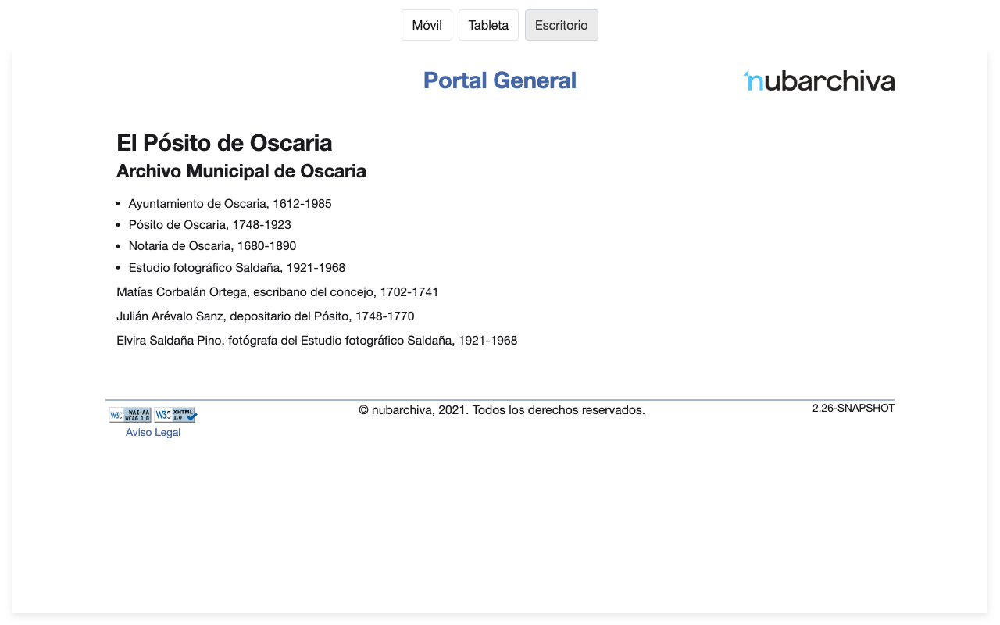
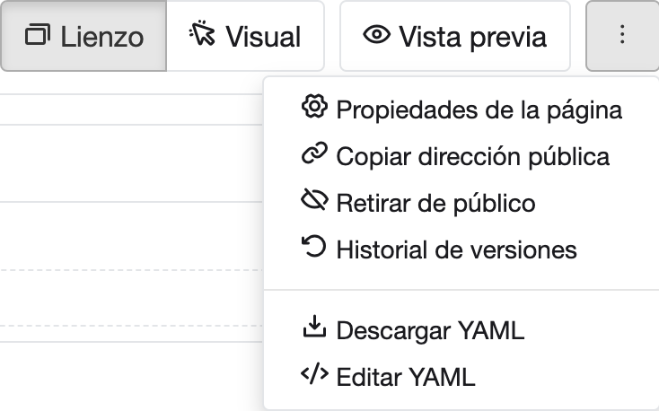
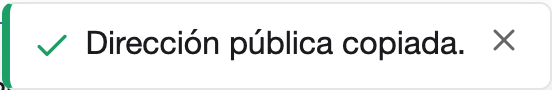

# Publicar una página y ver cómo la ve un visitante

Los visitantes del portal no ven nada de lo que cambias hasta que publicas. Una vez publicada, el editor te da la
dirección pública de la página, la que puedes compartir o enlazar.

## Ver la página en cada dispositivo

Antes de publicar, puedes ver la página con tus cambios tal como la verá un visitante en un móvil, una tableta o un
ordenador.

1. Abre la página en el editor ([Antes de empezar](index.md#antes-de-empezar)).
2. Pulsa **Vista previa**. Se abre una pestaña nueva con la página, la cabecera y el pie de la web pública, sin el
   menú de nubarchiva.
3. Arriba, pulsa **Móvil**, **Tableta** o **Escritorio**. La página se dibuja con el ancho de ese dispositivo: 375,
   768 o 1280 píxeles. La pestaña se abre en **Escritorio**.

    { width="251" }

4. Si haces más cambios en el editor, recarga la pestaña de la vista previa para verlos. Al recargarla, vuelve a
   **Escritorio**.

Si la ventana es más estrecha que el dispositivo elegido, la página se ve más pequeña para que quepa a lo ancho, con
la misma disposición que tendría en ese dispositivo.

En la vista previa, una imagen configurada para ampliarse se abre ampliada sobre la página. Para seguir los enlaces o
buscar como lo haría un visitante, publica la página y abre su dirección pública en una ventana privada
([Copiar la dirección pública](#copiar-la-direccion-publica)).

## Publicar

1. Abre la página en el editor ([Antes de empezar](index.md#antes-de-empezar)).
2. Pulsa **Publicar**, en la barra de arriba del editor.
3. Sale el aviso «¡Publicado! Los visitantes ya ven tus cambios.».

    { width="415" }

4. El estado de la página pasa a **Publicada** y el botón **Publicar** desaparece hasta que hagas otro cambio.

## Copiar la dirección pública

1. Pulsa **Más acciones**, el último botón de la barra del editor, a la derecha de **Vista previa**.

    { width="367" }

2. Pulsa **Copiar dirección pública**. Sale el aviso «Dirección pública copiada.».

    { width="276" }

3. Pega la dirección donde quieras compartirla o enlazarla.

Si la página aún no se ha publicado, el menú dice «Publica la página para tener su dirección pública.» en lugar de
copiarla.

Para ver la página como un visitante sin cerrar tu sesión, pega la dirección en una ventana privada del navegador. La
página se ve sin pedir usuario ni contraseña, como la ve un visitante.

!!! warning "Si abres la dirección con la sesión abierta"
    Si pegas la dirección en una pestaña del mismo navegador en que tienes la sesión abierta, sale el aviso «Vas a
    entrar en la vista pública».

    - **Continuar a la vista pública** muestra la página, pero cierra tu sesión de gestión. Para seguir editando
      tendrás que volver a entrar.
    - **Volver a la gestión** mantiene tu sesión.

    La dirección que muestra la barra mientras sale este aviso no sirve para compartir la página. Usa siempre la que
    copia **Copiar dirección pública**.

!!! warning "La vista previa no sirve para compartir"
    **Vista previa** muestra tus cambios sin publicar y solo se ve con sesión iniciada. Quien la abra sin sesión
    llega a la pantalla de acceso. Para enlazar la página, usa siempre su dirección pública.

## Cambiar una página publicada

1. Haz el cambio en el editor. El estado de la página pasa a **Cambios sin publicar** y vuelve el botón **Publicar**.
2. Mientras no publiques, los visitantes siguen viendo la versión anterior en la dirección pública.
3. Pulsa **Publicar**. Al recargar la dirección pública, los visitantes ya ven el cambio.
