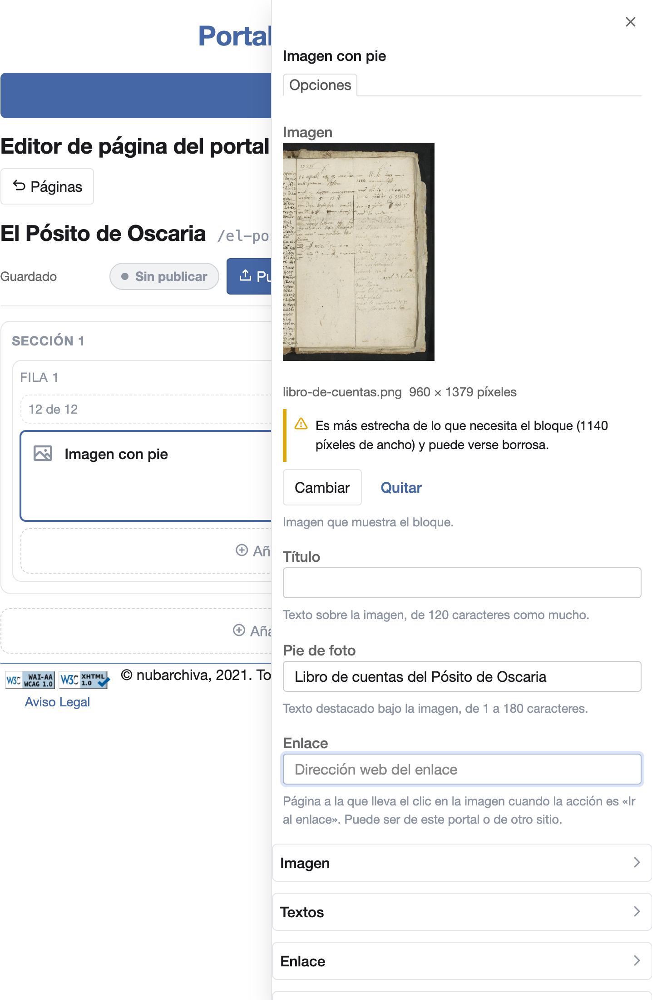

# Guardar los cambios y entender sus avisos

El editor guarda solo cada cambio, también en los elementos de una lista, como las imágenes de un carrusel: no hay
botón de guardar. Junto al estado de la página, un aviso te dice si se ha guardado.

## Guardar un cambio

Un cambio se guarda al salir del campo, con la tecla Tab o pulsando fuera de él. A la
izquierda del estado de la página aparece «Guardando…» y, enseguida, «Guardado».

{ width="241" }

Si recargas la página, el cambio sigue ahí.

Otros cambios, como añadir un bloque, se guardan igual aunque no muestren el aviso.

## Guardar un elemento

En los bloques con una lista de elementos, cada elemento se edita en la pestaña **Elementos**. **Añadir elemento**
crea uno y lo abre; pulsa un elemento de la lista para cambiarlo. Cada dato se guarda al salir del campo, y quitar o
mover un elemento, al pulsarlo. **← Volver** te lleva a la lista sin perder nada.

## Cuando falta un dato

Un dato que el bloque necesita y está vacío no impide guardar: el cambio se guarda y el editor te dice dónde
falta, sin mensajes que se cierren solos. Por ejemplo, si dejas sin **Portada** una colección de **Fondos y
colecciones**:

- El campo lleva la marca de aviso y, debajo, «Es un dato obligatorio.».
- En la lista de **Elementos**, la colección dice «Falta: Portada».
- La pestaña y el grupo plegado que contienen el campo llevan el icono de aviso con el número de datos que faltan.
- En la página, la tarjeta del bloque lleva ese mismo número. Al pulsarlo, se abre el bloque en el primer dato que
  falta.

Encima de las pestañas, un resumen dice cuántos datos faltan, por ejemplo «Faltan 2 datos en este bloque:», y los
nombra en el orden del formulario, con su elemento delante: «Planos y mapas»: **Portada**. Si faltan más de tres,
**Ver todos** enseña el resto. Al pulsar un nombre, el editor cambia de pestaña si hace falta, abre el elemento y el
grupo y deja el cursor en el campo. El editor no abre nada mientras no lo pulses.

Al completar el último dato, el resumen dice «No falta ningún dato en este bloque.» y desaparece la próxima vez que
abras el bloque.

## Cuando un valor no vale

Un valor que el campo no admite, como un número mayor que el máximo, no se guarda:

- Junto al estado de la página aparece «No se ha guardado».
- El campo conserva lo que escribiste y lleva la marca de error con el motivo debajo, por ejemplo «El valor debe ser
  menor o igual que 6.».
- Si el campo está en un grupo plegado, el grupo no se abre solo: su cabecera nombra el campo.

Corrige el valor. Al salir del campo aparece «Guardado» y la marca desaparece.

Si pulsas otro bloque o pasas a otra pestaña antes de corregirlo, lo escrito no se pierde: al volver, el campo sigue
con tu valor y marcado. Si recargas la página, vuelve al último valor que se guardó.

## Antes de publicar

Si a la página le falta algún dato o un contenido que ya no está, como una imagen borrada, **Publicar** lo lista
antes de publicar, una línea por cada uno. Pulsa una línea para ir a su campo, o publica igualmente
([Publicar](publish.md#publicar)). Lo que no se ha podido guardar por un valor que no vale no llega a los visitantes.
