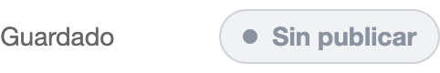
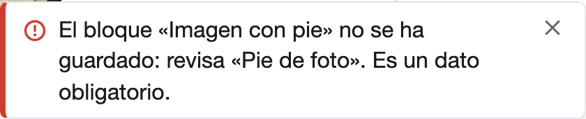

# Guardar los cambios y entender sus avisos

El editor guarda cada cambio de las opciones de un bloque solo: no hay botón de guardar. Los elementos de una lista,
como las imágenes de un carrusel, se guardan con **Guardar elemento**. Junto al estado de la página, un aviso te dice
si se ha guardado.

## Guardar un cambio

1. Abre la página en el editor ([Antes de empezar](index.md#antes-de-empezar)).
2. Pulsa un bloque para abrir sus opciones a la derecha ([Seleccionar un bloque](select-block.md)).
3. Cambia un campo, por ejemplo el **Pie de foto** de un bloque **Imagen con pie**.
4. Sal del campo con la tecla Tab o pulsando fuera de él.
5. A la izquierda del estado de la página aparece «Guardando…» y, enseguida, «Guardado».

    { width="241" }

Si recargas la página, el cambio sigue ahí.

Otros cambios, como añadir un bloque, se guardan igual aunque no muestren el aviso.

## Guardar un elemento

En los bloques con una lista de elementos, cada elemento se edita en la pestaña **Elementos**:

1. Pulsa **Añadir elemento**, o pulsa un elemento de la lista para cambiarlo.
2. Rellena sus campos.
3. Pulsa **Guardar elemento**. Aparecen «Guardando…» y «Guardado», y el elemento vuelve a la lista.

## Cuando un cambio no se guarda

Un campo vacío que el bloque necesita, o con un valor que no admite, no se guarda. Por ejemplo, el **Pie de foto**
de una **Imagen con pie** es obligatorio. Si lo dejas vacío, pasa esto:

- Junto al estado de la página aparece «No se ha guardado».
- El campo queda marcado, con el motivo debajo, por ejemplo «Es un dato obligatorio.».
- Abajo a la derecha sale un mensaje que dice qué bloque no se ha guardado y qué campo tienes que revisar. Nombra el
  bloque por su título o, si no lo tiene, por su tipo. En una **Imagen con pie** sin título dice: «El bloque «Imagen
  con pie» no se ha guardado: revisa «Pie de foto». Es un dato obligatorio.». El mensaje se cierra solo a los pocos
  segundos. También puedes cerrarlo con su botón **Cerrar**.

    { width="420" }

Si el campo está en un grupo plegado, el grupo no se abre solo: su cabecera lo nombra. Por ejemplo, si escribes
`500` en **Tiempo entre imágenes (milisegundos)** de un **Carrusel de cabecera**, la cabecera del grupo **Paso de las
imágenes** dice «Revisa: «Tiempo entre imágenes (milisegundos)»». Abre el grupo para corregirlo.

Para resolverlo:

1. Vuelve al campo marcado.
2. Corrígelo como dice el mensaje. En el ejemplo, escribe un pie de foto.
3. Sal del campo. Cuando aparece «Guardado», el cambio ya está guardado y la marca desaparece.

Si recargas la página sin corregirlo, el campo vuelve al último valor que se guardó.

### Si cambias de bloque antes de corregirlo

Si pulsas otro bloque, lo que habías escrito en el primero no se pierde. Al volver a él, sus campos tienen lo que
escribiste y el campo rechazado sigue marcado. Pasa lo mismo con el formulario de un elemento que no has guardado.

También se conserva si, en el mismo bloque, pasas de la pestaña **Elementos** a **Opciones**, o al revés. Al volver a
**Elementos**, el elemento que estabas editando sigue abierto con lo que escribiste.

## La imagen de un elemento es obligatoria

Un elemento de un bloque de imágenes necesita su imagen. Si pulsas **Guardar elemento** sin elegirla, el elemento no
se guarda:

- El campo **Imagen** queda marcado con «Es un dato obligatorio.».
- El mensaje dice qué falta, en qué elemento y en qué bloque, por ejemplo «No se ha guardado: falta «Imagen» en el
  elemento 1 de «Carrusel de cabecera». Complétalo y vuelve a guardar.».

Elige la imagen ([Elegir las imágenes de un bloque](choose-images.md)) y vuelve a pulsar **Guardar elemento**.

La imagen es obligatoria en los elementos de estos bloques:

- **Carrusel de cabecera**, **Tira de imágenes de cabecera** y **Carrusel de elementos**.
- **Galería ajustada** y **Fondos y colecciones**.
- **Cuadrícula de elementos** y **Mosaico de fotos**, mientras **Mostrar las imágenes** esté activada.

En **Fondos y colecciones**, la imagen del elemento es el campo **Portada**, y así la nombran el campo marcado y el
mensaje.

El título de un elemento sigue siendo opcional donde lo era: un elemento de carrusel con imagen y sin título se
guarda.

## Un elemento sin imagen en otro bloque

Una página puede tener ya un elemento al que le falta un dato obligatorio, por ejemplo si se preparó fuera del
editor. La primera vez que guardas un cambio en otro bloque después de abrir la página en el editor, el cambio se
guarda y sale un mensaje que señala lo que falta. Por ejemplo: «Se ha guardado. Falta «Imagen» en el elemento 1 de «Carrusel de cabecera»: complétalo.».

El editor abre ese bloque y ese elemento, con el campo marcado. Elige la imagen y pulsa **Guardar elemento**. Los
guardados siguientes ya no avisan de ese elemento.

Si en ese bloque tienes un elemento a medio editar, sin guardar, el editor abre el bloque, pero no el elemento que
falla: tu formulario se queda como estaba. Guárdalo y abre después el elemento que nombra el mensaje.
