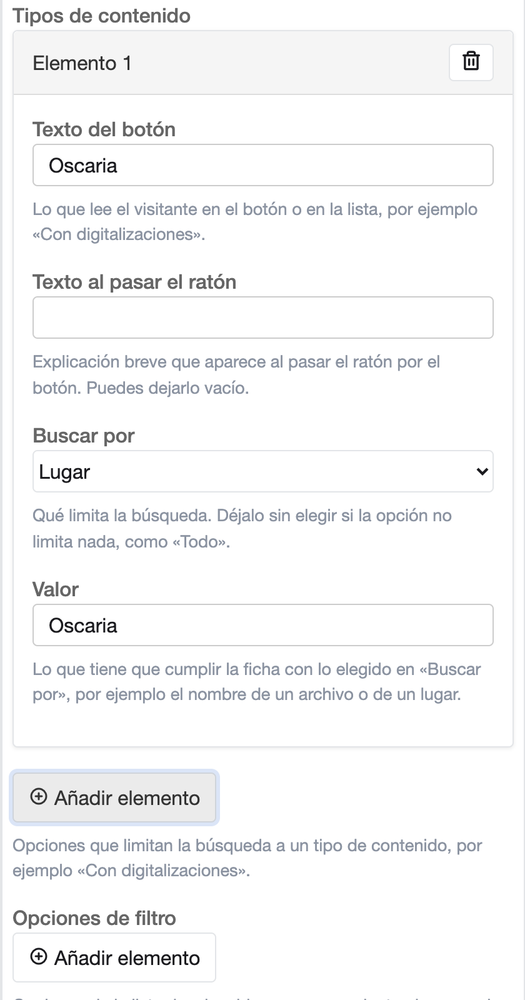

# Configurar la caja de búsqueda

El bloque **Caja de búsqueda** pone en la página un buscador del catálogo del archivo. Puede llevar un enlace a la
búsqueda avanzada y unos tipos de contenido para buscar solo en una parte del catálogo, como las series.

## Añadir la caja de búsqueda

1. Abre la página en el editor ([Antes de empezar](index.md#antes-de-empezar)).
2. Pulsa **Añadir bloque** y elige **Caja de búsqueda**. Sus opciones se abren a la derecha.
3. Arriba están las opciones que definen su contenido: **Título**, **Subtítulo** e **Imagen de fondo**. Las tres son
   opcionales.
4. Las demás están en grupos plegados. Pulsa el nombre de un grupo para abrirlo
   ([Ver y cambiar las demás opciones de un bloque](block-options.md)). Por ejemplo, en **Textos** está el **Texto
   dentro del campo vacío**, que se lee en el buscador antes de escribir.

La caja llega con un ejemplo: un título, un subtítulo, un texto dentro del campo vacío y una imagen de fondo. Cámbialos
por los tuyos. La imagen se cambia con **Cambiar** ([Cambiar o quitar la imagen](choose-images.md#cambiar-o-quitar-la-imagen)).
Si no quieres algún texto o la imagen, déjalo vacío o pulsa **Quitar**. El ejemplo no trae tipos de contenido.

## El enlace a la búsqueda avanzada

Pulsa el grupo **Búsqueda avanzada**:

1. En **Al pulsar la búsqueda avanzada**, elige qué pasa al pulsar el enlace:
   - **Ir a otra página**, la que tiene una caja nueva: el enlace lleva a la página cuya dirección está en **Página de
     búsqueda avanzada**. Si está vacía, el enlace no aparece, así que una caja nueva sale sin enlace.
   - **Abrir la búsqueda avanzada en la caja**: el formulario de búsqueda avanzada se abre en la misma caja, sin salir
     de la página.
   - **Abrir la búsqueda experta en la caja**: igual, con el formulario de búsqueda experta.
2. En **Icono del enlace de búsqueda avanzada**, elige el icono que acompaña al texto del enlace: **Flecha**, la que
   tiene una caja nueva, **Prismáticos**, **Lupa**, **Más**, **Engranaje**, **Carpeta** o **Enlace**.
3. El texto del enlace se cambia en el grupo **Textos**, **Texto del enlace de búsqueda avanzada**.

## Los tipos de contenido

Los tipos de contenido limitan la búsqueda a una parte del catálogo, por ejemplo a las fichas con digitalizaciones o
a las series. Solo aparecen si la caja tiene alguno.

Para añadir uno:

1. Pulsa el grupo **Filtros**.
2. Activa **Mostrar los tipos de contenido**. Una caja nueva la tiene desactivada.
3. Debajo de **Tipos de contenido**, pulsa **Añadir elemento**. Aparece «Elemento 1» con sus campos vacíos.

Sus campos son estos:

- **Texto del botón**: lo que verá el visitante, por ejemplo `Series`.
- **Texto al pasar el ratón**: una explicación breve. Es opcional.
- **Buscar por**: qué limita la búsqueda. La ayuda de **Valor** cambia para decirte qué escribir:
    - **Con o sin digitalizaciones**: en **Valor**, `1` busca solo las fichas con digitalizaciones y `0`, las que no
      tienen ninguna.
    - **Nivel de descripción**: en **Valor**, el número de ese nivel en tu archivo.

{ width="401" }

Mientras al elemento le falte un dato obligatorio, al escribir en él sale un aviso que nombra el campo, el número del
elemento y la lista. Con **Eliminar elemento** quitas un tipo.

Para saber el número de un nivel de descripción, pulsa **Búsqueda** en el menú superior y después **Búsqueda
avanzada**. En **Nivel de descripción**, desmarca **Todos**, marca solo ese nivel, escribe un término y pulsa
**Buscar**. En la dirección de los resultados, el número que sigue a `al=` es el del nivel. Por ejemplo, en
`results?q=san&al=5&ob=re:1` el número del nivel es `5`.

En el mismo grupo **Filtros**, elige cómo se ofrecen:

| Opción | Qué hace |
|---|---|
| **Mostrar los tipos de contenido** | Muestra u oculta los tipos de contenido. El enlace a la búsqueda avanzada se mantiene. Una caja nueva la tiene desactivada. |
| **Forma de los tipos de contenido** | **Botones**: un botón por tipo, debajo del buscador. **Lista desplegable**: una lista «Tipo de contenido» que empieza por «Todos los tipos». |

## Las opciones de filtro

Las **Opciones de filtro**, también en el grupo **Filtros**, forman una lista desplegable junto al campo de búsqueda.
El visitante elige una antes de buscar. Cada opción se añade con **Añadir elemento**, como un tipo de contenido:

- **Texto de la opción**: lo que lee el visitante en la lista, por ejemplo `Solo fichas con digitalizaciones`.
- **Nombre corto de la opción**: una palabra que la distingue de las demás, por ejemplo `digitalizadas`. El visitante
  no la ve.
- **Buscar por** y **Valor**: como en los tipos de contenido.

La lista empieza por la primera opción. Si quieres que el visitante busque en todo sin elegir nada, pon primero una
opción como `Todo` y deja su **Buscar por** sin elegir.

## Comprobar el resultado

1. Pulsa **Vista previa**.
2. Busca un término con un tipo elegido. Con **Botones**, pulsa el tipo para marcarlo; con **Lista desplegable**,
   elígelo en la lista. Los resultados se limitan a ese tipo.
3. Cuando esté a tu gusto, vuelve al editor y pulsa **Publicar**.
