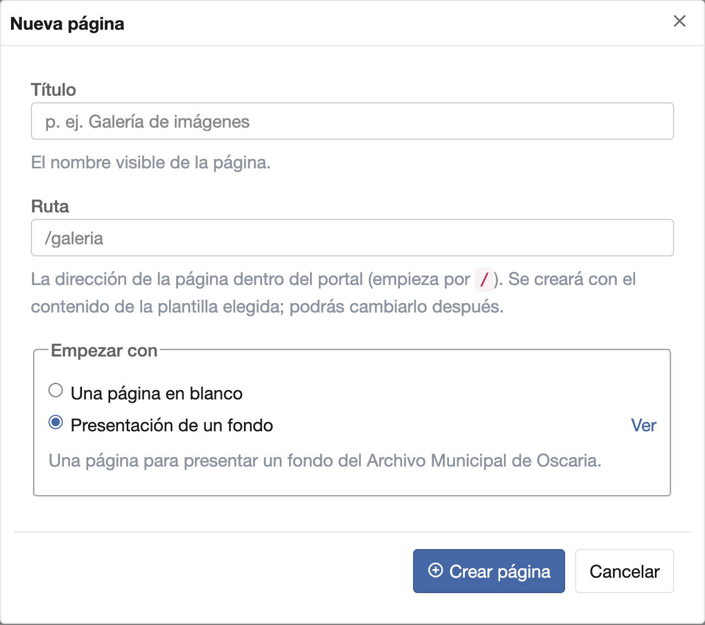
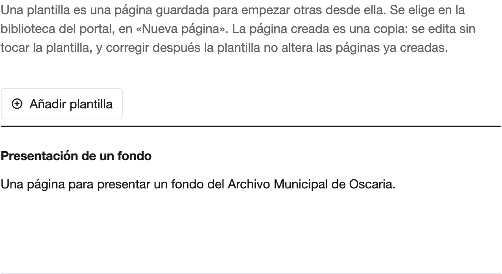
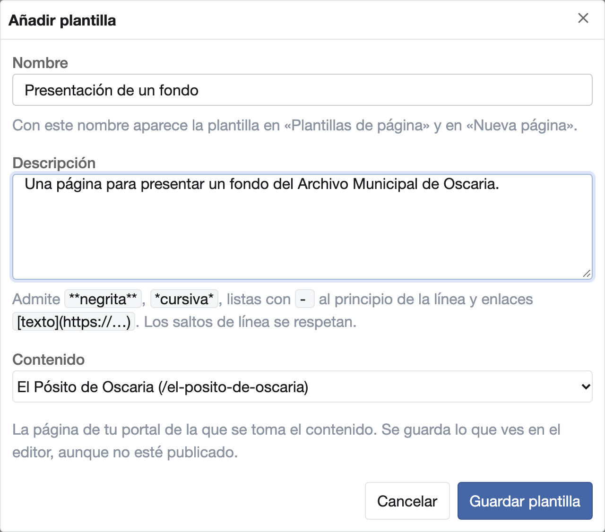

# Empezar desde una plantilla y mantenerlas

Una página nueva puede empezar con el contenido de una plantilla, una página guardada para ese fin. La página que
creas es una copia: la editas sin tocar la plantilla, y corregir después la plantilla no cambia las páginas ya
creadas.

## Empezar una página desde una plantilla

1. En la lista de **Páginas**, pulsa **Nueva página** ([Antes de empezar](index.md#antes-de-empezar)).
2. En **Empezar con**, elige una plantilla. Bajo su nombre se lee su descripción, y la ayuda de la **Ruta** avisa de
   que la página se creará con el contenido de la plantilla. Con **Una página en blanco** no hay contenido de
   partida.

    { width="640" }

**Empezar con** solo aparece si el portal tiene plantillas.

La página nace como borrador: los visitantes no la ven hasta que la publicas ([Publicar una página](publish.md)). Si la
plantilla conserva textos o imágenes del ejemplo de un bloque, la página también los conserva, y al publicarla sale el
aviso de contenido de ejemplo
([Si la página conserva contenido del ejemplo](publish.md#si-la-pagina-conserva-contenido-del-ejemplo)).

Las imágenes y los vídeos de la plantilla son los de **Imágenes y vídeos del portal**. La página creada los muestra
sin que se copie nada.

## Añadir una plantilla

Quien administra el portal mantiene las plantillas. En **Administración**, apartado **General**, pulsa **Plantillas de
página**.

{ width="638" }

1. Pulsa **Añadir plantilla**.
2. En **Contenido**, elige la página de tu portal de la que se toma el contenido. Se guarda lo que ves en el editor,
   aunque no esté publicado.
3. Pulsa **Guardar plantilla**.

    { width="640" }

El **Nombre** es obligatorio y puede repetirse. Con él aparece la plantilla en **Plantillas de página** y en **Nueva
página**. La **Descripción** admite negrita, cursiva, listas y enlaces.

También se guarda una página como plantilla desde su editor: en **Más acciones**, pulsa **Guardar como
plantilla…**. El **Nombre** se propone con el título de la página. Al guardar sale el aviso «Se ha guardado la plantilla
«…».».

## Corregir una plantilla

La plantilla no se edita en el editor de páginas, que trabaja con páginas. Para corregir su contenido:

1. Crea una página desde la plantilla y corrígela. No hace falta publicarla.
2. En **Plantillas de página**, pulsa **Editar** en la plantilla.
3. En **Contenido**, elige esa página y pulsa **Guardar plantilla**.

Con **Contenido** vacío se conserva el contenido actual y solo cambian el **Nombre** y la **Descripción**.

## Ocultar y eliminar una plantilla

- **Ocultar** retira la plantilla de **Nueva página**. En **Plantillas de página** sigue visible con la marca
  **Oculta**, y **Mostrar** la devuelve a **Nueva página**.
- **Eliminar** pide confirmación: pulsa **Eliminar plantilla**. Se borran su contenido y su descripción, y no se puede
  deshacer. Las páginas creadas desde ella no cambian.
