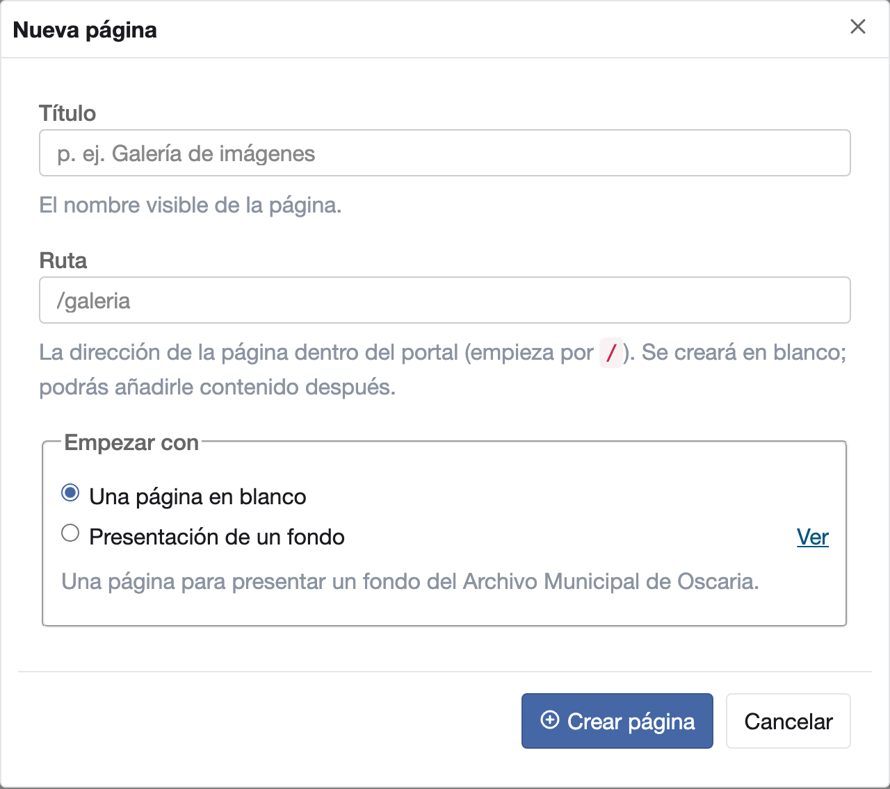

# Empezar desde una plantilla

Una página nueva puede empezar con el contenido de una plantilla, una página guardada para ese fin. La página que
creas es una copia: la editas sin tocar la plantilla, y corregir después la plantilla no cambia las páginas ya
creadas.

## Empezar una página desde una plantilla

1. En la lista de **Páginas**, pulsa **Nueva página** ([Antes de empezar](index.md#antes-de-empezar)).
2. En **Empezar con**, elige una plantilla. Bajo su nombre se lee su descripción, y la ayuda de la **Ruta** avisa de
   que la página se creará con el contenido de la plantilla. Con **Una página en blanco** no hay contenido de
   partida.

    { width="640" }

**Empezar con** solo aparece si el portal tiene plantillas. Para ver una antes de elegirla, pulsa **Ver**, que sale al
pasar el ratón por la plantilla o al llegar a ella con Tab: se abre en otra pestaña cómo queda la página.

{ width="640" }

La página nace como borrador: los visitantes no la ven hasta que la publicas ([Publicar una página](publish.md)). Si la
plantilla conserva textos o imágenes del ejemplo de un bloque, la página también los conserva, y al publicarla sale el
aviso de contenido de ejemplo
([Si la página conserva contenido del ejemplo](publish.md#si-la-pagina-conserva-contenido-del-ejemplo)).

La página creada usa las imágenes y los vídeos de la plantilla, que están en **Imágenes y vídeos del portal**.

Quien administra el portal añade, actualiza, oculta y elimina las plantillas ([Mantener las plantillas](maintain-templates.md)).
