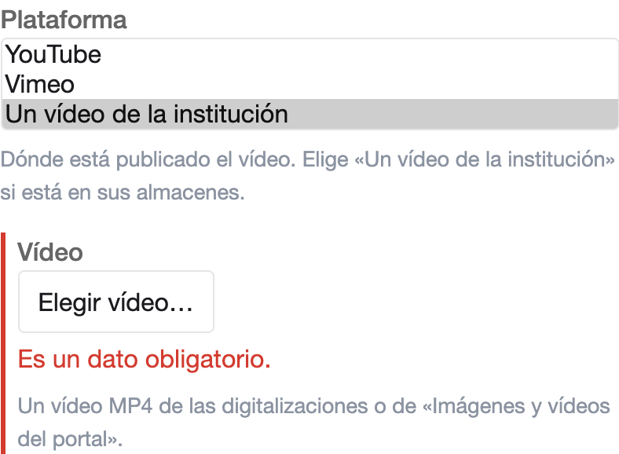
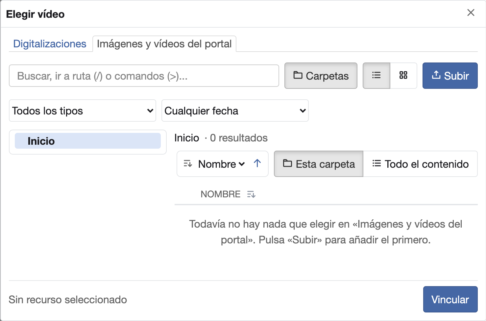

# Poner un vídeo

El bloque **Vídeo** reproduce un vídeo dentro de la página. El vídeo puede estar en YouTube, en Vimeo o en los
almacenes de tu institución.

Pulsa **Añadir bloque** y elige **Vídeo** ([Antes de empezar](index.md#antes-de-empezar)). Llega con un vídeo de
ejemplo de YouTube, con su título y su pie. Para poner el tuyo, elige en **Plataforma** dónde está publicado. Las
opciones de abajo cambian según la plataforma.

{ width="420" }

## Un vídeo de YouTube

Con **YouTube**, copia en **Código del vídeo** lo que sigue a «v=» en la dirección del vídeo. Para una lista de
reproducción, copia en **Código de la lista de reproducción** lo que sigue a «list=». Hace falta uno de los dos códigos.

Con **Forma de mostrarlo**, en el grupo **Aspecto**, el vídeo se reproduce en la página o se muestra como una imagen
que lo abre en YouTube al pulsarla. La imagen necesita el código del vídeo.

## Un vídeo de Vimeo

Con **Vimeo**, copia la dirección del vídeo en **Dirección del vídeo en Vimeo**, por ejemplo
`https://vimeo.com/76979871`. Si el vídeo se comparte con un enlace privado, copia ese enlace entero.

## Un vídeo de la institución

Con **Un vídeo de la institución**, el campo **Vídeo** muestra el botón **Elegir vídeo…**. El diálogo **Elegir
vídeo** tiene las pestañas **Digitalizaciones** e **Imágenes y vídeos del portal**. El vídeo ha de ser un MP4. Mientras
el campo está vacío, avisa «Es un dato obligatorio.».

{ width="740" }

Para subir un vídeo de tu equipo:

1. En el diálogo, abre la pestaña **Imágenes y vídeos del portal** y entra en la carpeta donde quieres guardarlo.
2. Pulsa **Subir**. Si la instalación fija un tamaño máximo, la ayuda de la subida lo dice, por ejemplo: «Vídeo MP4 de
   hasta 100 MB.».

Subir funciona como con las imágenes
([Subir una imagen desde el diálogo](choose-images.md#subir-una-imagen-desde-el-dialogo)).

Si la pestaña no ofrece **Subir** y avisa «Este almacén no admite subir vídeos MP4. Para subir uno, pide a quien
administra el portal que lo permita.», la instalación no admite vídeos MP4 en ese almacén.

Si el vídeo no se reproduce, expórtalo de nuevo como MP4 (H.264) desde tu programa de vídeo. Si es largo, es preferible
publicarlo en YouTube o Vimeo.

## Reproducir al abrir la página y sin sonido

En el grupo **Reproducción**, **Reproducir al abrir la página** hace que el vídeo empiece solo. La mayoría de los
navegadores solo lo permiten con **Sin sonido** activada. Con YouTube, ambas opciones solo se aplican con
**Reproductor en la página**.

## Comprobar el resultado

Pulsa **Vista previa** y reproduce el vídeo antes de publicar la página ([Publicar una página](publish.md)).

Los textos del ejemplo cuentan como contenido de ejemplo al publicar: cambia el **Título** y el **Pie del vídeo**
([Si la página conserva contenido del ejemplo](publish.md#si-la-pagina-conserva-contenido-del-ejemplo)).
