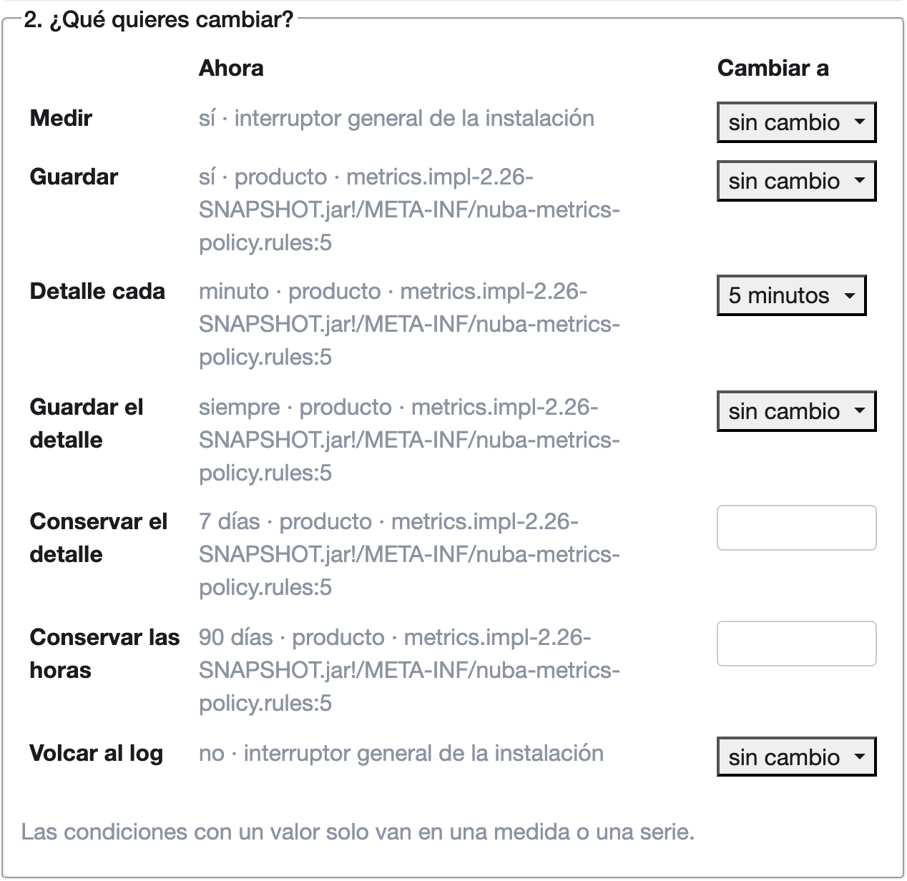

# Cambiar la política de almacenamiento

Un cambio fija qué se guarda y con qué detalle de toda la instalación, de un grupo de medidas, de una medida o de una
serie. Rige en cada nodo en menos de 30 segundos, sin reiniciar.

Solo puede cambiar la política quien tiene el permiso para hacerlo ([Antes de empezar](index.md#antes-de-empezar)).

## Añadir un cambio

1. En **Política**, pulsa **Añadir un cambio**. Se abre **Cambiar la política**.
2. En **1. ¿A qué se aplica?**, elige **Toda la instalación**, **Un grupo de medidas**, **Una medida** o **Una serie**.
   Salvo con la primera, elige después en su lista el grupo, la medida o la serie. Las listas ofrecen lo que mide
   ahora el nodo que te sirve la página.
3. En **2. ¿Qué quieres cambiar?**, cada campo muestra en **Ahora** su valor y de dónde sale. En **Cambiar a**, elige
   el valor nuevo de lo que quieras cambiar. Deja lo demás en «sin cambio», o vacío en los días que se conservan. En
   el ejemplo, el grupo **nuba.process.** pasa a guardar su detalle cada 5 minutos.

    { width="634" }

4. Revisa **3. Resultado**. Dice a cuántas series de este nodo se aplica y cuántas filas al día se guardarían antes y
   después, por ejemplo «Series de este nodo a las que se aplica: 2. Filas al día: de como mucho 122.520 a como mucho
   120.216.». Debajo va la regla que se va a guardar, como `nuba.process. period=5`.
5. Pulsa **Guardar el cambio**. Vuelves a la **Política** con el aviso «Cambio guardado en la revisión 1. Rige en menos
   de 30 segundos en cada nodo.».

**Guardar el cambio** sale desactivado hasta que hay algo que guardar. Algunos campos no salen en todos los niveles, y
una línea dice por qué, como «Medir y volcar al log no se cambian para toda la instalación: los decide su interruptor
general.».

Si ya conoces la gramática de la política, despliega **Escribir la regla** y escríbela, por ejemplo
`nuba.cache. store=no`. Lo que escribas ahí se guarda en lugar de lo elegido arriba.

## Si el cambio no se guarda

Cada destino admite un solo cambio de esta instalación. Si ya hay uno, **3. Resultado** lo avisa antes de guardar, con
«Ya hay un cambio de esta instalación con ese destino, el cambio 5. Quítalo antes de añadir otro.» y el enlace **Ver los
cambios de esta instalación**, y **Guardar el cambio** sigue desactivado. Hasta que el nodo lee un cambio recién
guardado, en menos de 30 segundos, **3. Resultado** todavía no lo tiene en cuenta. Mientras tanto, el aviso sale al
guardar y empieza por «El cambio no se guarda.». Si quitas ese cambio, el aviso sigue hasta que el nodo lee que lo has
quitado.

Si otra persona cambia la política mientras preparas el tuyo, sale «Otra persona ha cambiado la política mientras
preparabas el cambio, y no se ha guardado nada. Revisa los valores de ahora y vuelve a guardar.». Lo que habías elegido
o escrito sigue en el formulario.

## Quitar un cambio

1. En **Política**, en **Cambios de esta instalación**, pulsa **Quitar** junto al cambio. No pide confirmación.
2. Sale el aviso «Cambio quitado en la revisión 2. Deja de regir en menos de 30 segundos en cada nodo.».

Quitar un cambio no borra lo guardado, y el cambio sigue en **Historial de cambios**
([Ver qué política de almacenamiento rige](read-policy.md)). Los valores del producto y los ajustes del cliente no se
quitan desde esta pantalla.
