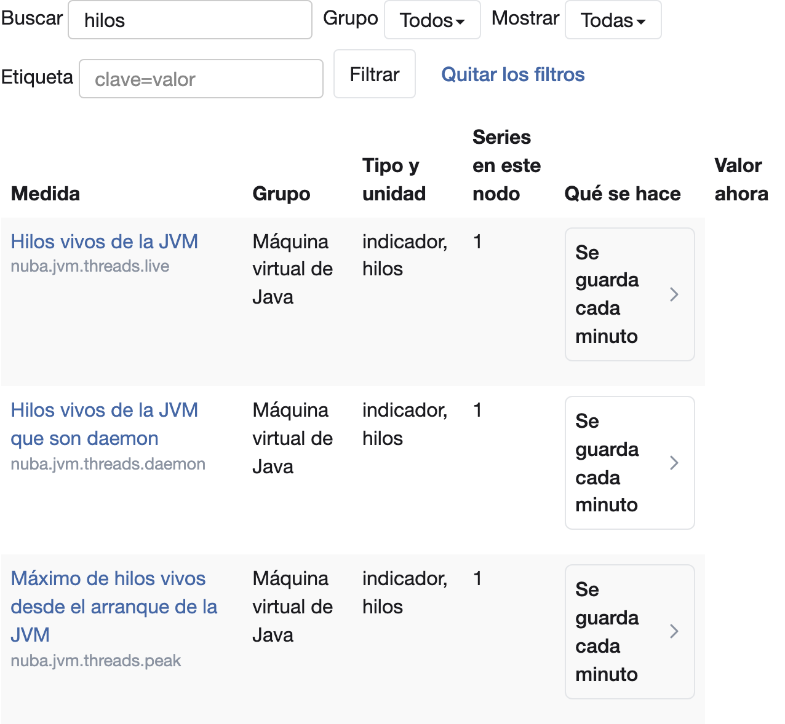

# Encontrar una medida

En **Medidas** buscas una medida por lo que mide o por su nombre técnico y abres su ficha, donde están su valor de
ahora, qué se hace con ella y su historia.

Abre **Métricas** y pulsa **Medidas** en la barra de apartados ([Antes de empezar](index.md#antes-de-empezar)).

## Buscar la medida

1. Escribe en **Buscar** una parte de la descripción o del nombre técnico, por ejemplo «hilos».
2. Si quieres acotar más, elige un **Grupo** o una opción de **Mostrar**, o escribe una etiqueta en **Etiqueta** con
   la forma `clave=valor`. Después pulsa **Filtrar**.

{ width="638" }

En **Mostrar** puedes elegir **Con historia guardada**, **No se guardan** o **Con cambios del cliente o de esta
instalación**. **Quitar los filtros** vuelve a mostrar todas las medidas.

Cada fila es una medida. Lleva su descripción, con el nombre técnico debajo, que es el nombre con que aparece en el log.
Después van el grupo, el tipo y la unidad, cuántas series tiene en el nodo que te sirve la página, qué se hace con
ella y cuánto vale ahora. Si pulsas la frase de **Qué se hace**, se despliega de dónde sale cada valor de su política.
La tabla muestra 25 medidas por página.

## Abrir la ficha

Pulsa la descripción de la medida. Se abre la **Ficha de la medida**, con su nombre técnico, su tipo y su grupo, el
**Valor ahora** y **Qué se hace con ella**. Debajo van su historia ([Ver la historia de una
medida](read-history.md)) y sus series.

Si puedes cambiar la política, **Cambiar qué se hace con ella** abre **Cambiar la política** con la medida ya elegida
([Cambiar la política de almacenamiento](change-policy.md)). **Cancelar** te devuelve a la ficha.

**Volver a las medidas** te lleva al catálogo con la búsqueda y los filtros que tenías.
