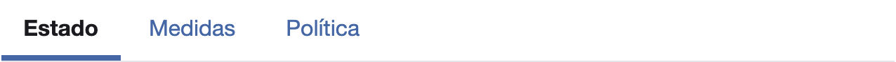

# Métricas

Las métricas cuentan cómo trabaja tu instalación de nubarchiva. Cada nodo mide lo que hace la aplicación y guarda un
resumen en la base de datos, según una política que dice qué se guarda y durante cuánto tiempo. Esta sección explica
cómo comprobar que la medición funciona, cómo detenerla y cómo cambiar esa política.

## Tareas

- [Comprobar si cada nodo mide y guarda](node-status.md)
- [Detener y reanudar la medición](stop-measurement.md)
- [Ver qué política de almacenamiento rige](read-policy.md)
- [Cambiar la política de almacenamiento](change-policy.md)

## Antes de empezar

Para ver las métricas necesitas una cuenta con permiso para ver la información del sistema. Para detener la medición
y para ver o cambiar la política necesitas además el permiso que cambia la política. En una instalación sin
personalizar, los dos los tiene el rol de administración. Sin el segundo no ves **Política** ni **Detener la
medición**.

En **Administración**, apartado **Sistema**, pulsa **Métricas**. Se abre el **Estado**. La barra de arriba lleva a los
otros apartados, **Medidas** y **Política**.

{ width="638" }

Bajo la barra, una línea dice en qué nodo estás y cada cuánto mide, con el nombre del nodo en lugar de los puntos:
«Estás en el nodo …. Mide cada 30 s.». Si la medición de ese nodo está detenida, la línea dice solo en qué nodo estás.

## Qué es un nodo

Cada servidor de aplicación que atiende tu instalación es un nodo. Si la instalación funciona con un solo servidor,
tiene un nodo. Cada nodo mide por su cuenta y escribe en la base de datos solo lo suyo, así que el **Estado** los
lista por separado. Las páginas de métricas que abres te las sirve uno de ellos, el que lleva la etiqueta **Este
nodo**.
