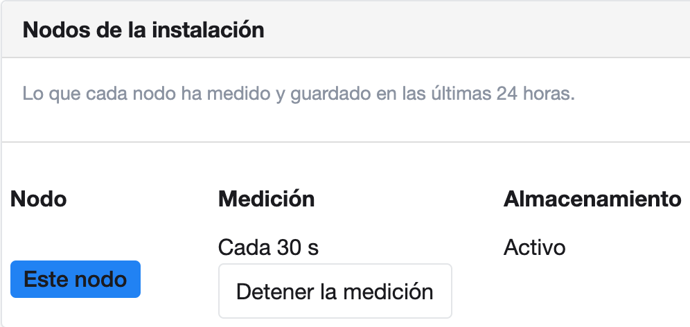

# Comprobar si cada nodo mide y guarda

El **Estado** dice, nodo a nodo, si la aplicación está midiendo y si guarda lo que mide en la base de datos. Abarca las
últimas 24 horas, así que también muestra los arranques y las horas en que un nodo dejó de medir.

1. Abre **Métricas** ([Antes de empezar](index.md#antes-de-empezar)). Se abre en el **Estado**.
2. En **Nodos de la instalación**, busca la fila de cada nodo. El que te sirve la página lleva la etiqueta **Este
   nodo**.

    { width="498" }

3. Para leer el estado de nuevo, pulsa **Actualizar**. Al lado sale la hora de la lectura, por ejemplo «Leído a las
   10:30:20». La página no se actualiza sola.

Si ningún nodo ha medido en las últimas 24 horas, como al poner en marcha la instalación, la tabla dice «Ningún nodo
ha guardado métricas en las últimas 24 horas.». Un nodo que empieza a medir aparece al minuto siguiente; pulsa
**Actualizar** pasado ese tiempo.

## Qué dice cada columna

La columna **Medición** de tu nodo dice lo que rige en él en ese momento:

- «Cada 30 s», o la cadencia que tenga, si mide.
- «En pausa» si alguien ha detenido la medición de este nodo hasta el próximo reinicio.
- «Desactivada» si se ha detenido en toda la instalación.
- «Apagada» si la medición no está activa en la configuración.

De los demás nodos, la página solo sabe lo que cada uno deja anotado en la base de datos al medir, guarde o no lo
medido. Por eso su **Medición** dice «Mide» si han medido en los últimos cinco minutos, y si no, «Sin medir desde las» y
la hora en que acaba el último minuto que anotaron. Cuando se detiene la medición de otro nodo, sigue apareciendo con
«Mide» entre cinco y seis minutos más. Si la medición se desactiva, el nodo deja de medir al releer su configuración, en
menos de un minuto.

En **Almacenamiento** sale «Activo» si el nodo guarda lo que mide y «Apagado» si mide sin guardar. Si el nodo no mide,
sale «—». **Último minuto guardado** es la hora del último minuto que el nodo escribió en la base de datos, y
**Arranques**, las horas a las que arrancó, o «Ninguno».

En **Horas sin medir** aparecen los tramos sin medición, como «Sin medir: 03:00 a 04:00», o «Ninguna». La cifra de
**Descartadas por límite** cuenta las series que el nodo midió y no guardó porque pasaban del máximo de series que
admite.

La última columna, **Política**, dice qué revisión de la política aplica el nodo, como «Aplica la revisión 2». Justo
después de un cambio sale «No ha aplicado todavía la revisión 3 de la política» hasta que el nodo la lee, en menos de
30 segundos ([Cambiar la política](change-policy.md)).

## La historia guardada

Bajo la tabla, **Historia** dice desde cuándo hay datos y cuánto se conservan. Por ejemplo: «El detalle por minuto
empieza el 17/11/2026 23:48 y se conserva 7 días. El resumen por horas empieza el 17/11/2026 23:00 y se conserva 90
días. La limpieza de lo antiguo está al día.».

Si la limpieza no ha borrado todavía lo que pasó de su plazo, la última frase dice «La limpieza de lo antiguo no está
al día porque quedan periodos anteriores a su plazo.». Los plazos los fija la política
([Ver qué política de almacenamiento rige](read-policy.md)).
