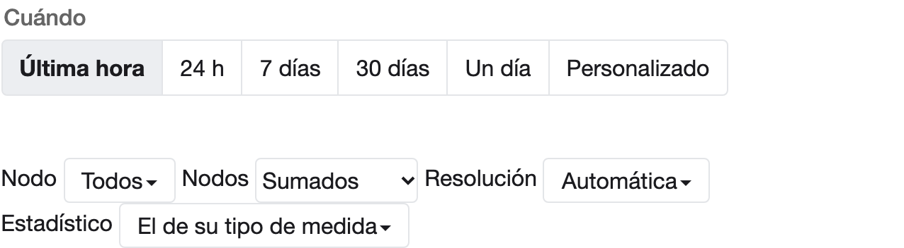

# Ver la historia de una medida

La **Historia** de la ficha muestra lo que se guardó de una medida en el intervalo que eliges, con los nodos sumados o
cada uno por separado. Lo muestra en una gráfica y en una tabla.

Abre la ficha de la medida ([Encontrar una medida](find-measure.md)). La historia va debajo de **Qué se hace con
ella**.

## Elegir el intervalo y los nodos

1. En **Cuándo**, elige **Última hora**, **24 h**, **7 días**, **30 días**, **Un día** o **Personalizado**. Al lado,
   una frase dice el intervalo, por ejemplo «00:30 a 01:30 del 20/11/2026».
2. En **Nodo**, deja **Todos** o marca los nodos que quieras ver.
3. En **Nodos**, elige **Sumados** para ver los nodos juntos o **Por separado** para ver cada nodo en su línea.
4. En **Resolución**, deja **Automática** o elige **Por minuto** o **Por horas**.

{ width="638" }

La historia se vuelve a leer con cada elección. Con **Un día**, eliges el día en **Día** o pasas de uno a otro con
**Día anterior** y **Día siguiente**. Con **Personalizado**, escribes **Desde** y **Hasta** y pulsas **Aplicar**.

Debajo de los controles, una línea dice la resolución y la fecha de lo más antiguo que se conserva, por ejemplo «Por
minuto: el detalle se conserva 7 días. Lo más antiguo que se conserva es del 20/11/2026.».

## Leer lo guardado

Lo primero es la gráfica ([Leer la gráfica de una medida](read-chart.md)). Si en el intervalo no hay nada guardado,
en su lugar sale un aviso con el motivo, como «No hay nada guardado de esta medida en este intervalo: no estaba
midiendo o no pudo escribir en la base de datos.».

Para ver los números, despliega **Ver los datos**. La tabla tiene una fila por periodo. Con una sola línea, sus
columnas son los valores del periodo, como **mínimo**, **máximo**, **media** y **último** en una medida de tipo
indicador. Con varias líneas, cada línea va en una columna con el valor que eliges en **Estadístico**. Los periodos sin
datos van en una fila con su motivo ([Saber por qué falta un periodo](read-gap.md)).

## Elegir las series

Una medida con etiquetas tiene varias series, como `class=identified` y `class=preferred`. La historia lleva como
mucho 5 líneas, una por serie. Con **Por separado**, cada serie ocupa una línea por nodo. Si quedan líneas fuera, lo
avisa, por ejemplo con «Se muestran 5 de 12 líneas. Elige las series o los nodos para ver otras.».

Para ver otras series, ve a **Series**, al final de la ficha, y marca **En la historia** en las que quieras. Si la
medida tiene muchas, filtra antes la lista por el valor de sus etiquetas.
