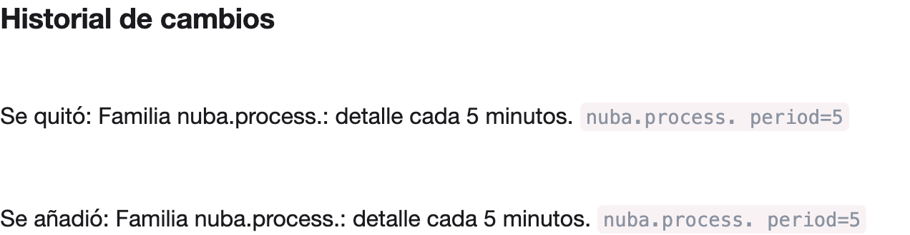

# Ver qué política de almacenamiento rige

La **Política** dice qué se guarda de cada medida en la base de datos, con qué detalle y durante cuánto tiempo. También
dice quién la ha cambiado y cuándo.

Abre **Métricas** y pulsa **Política** en la barra de apartados ([Antes de empezar](index.md#antes-de-empezar)).

Arriba, una línea dice qué revisión rige, por ejemplo «Rige la revisión 2, de admin, del 17/11/2026 23:49.». Cada
cambio que se guarda o se quita crea una revisión nueva. Mientras nadie haya cambiado nada, esta línea no sale. Debajo
va la política por partes, de lo que se ha cambiado en tu instalación a lo que trae nubarchiva.

La política tiene tres orígenes. Para cada medida, y para cada uno de sus valores, rige la regla más concreta. Si dos
reglas son igual de concretas, manda un cambio de esta instalación sobre un ajuste del cliente, y un ajuste del
cliente sobre un valor del producto.

## Cambios de esta instalación

Son los cambios que ha guardado alguien con permiso desde **Añadir un cambio**. Cada uno sale como una frase con el
botón **Quitar**.

{ width="636" }

Debajo de la frase van la regla escrita, quién la guardó y cuándo, y a cuántas series se aplica en el nodo que te
sirve la página. Si no hay ninguno, la página dice «Esta instalación no ha cambiado nada: rigen los valores del
producto y los ajustes de tu cliente.». Cómo se añaden y se quitan está en
[Cambiar la política de almacenamiento](change-policy.md).

## Ajustes del cliente

Una instalación se puede personalizar con una política propia, que se entrega con la aplicación y no se cambia desde
esta pantalla. Si la tuya no la trae, la página dice «Tu cliente no ajusta la política: rigen los valores del producto
y los cambios de esta instalación.».

## Valores del producto

Es la política con que nubarchiva llega a cualquier instalación, agrupada y plegada. Pulsa el nombre de un grupo para
desplegarlo. **Toda la instalación** fija lo que rige para todas las medidas: «Toda la instalación: se guarda, detalle
cada minuto, guarda el detalle siempre, conserva el detalle 7 días, conserva las horas 90 días.». Los demás grupos,
como **cache** o **jvm**, ajustan algunas medidas, por ejemplo «Medida nuba.cache.size: no se guarda.».

## Historial de cambios

Al final de la página está cada revisión, de la más reciente a la más antigua, con quién la hizo y cuándo, por ejemplo
«Revisión 2 · admin · 17/11/2026 23:49». Debajo dice qué cambio se añadió y cuál se quitó.

{ width="636" }

Un cambio quitado deja de regir, pero sigue en el historial.

## Buscar una regla

Para ver solo una parte de la política, elige una o varias capas en **Capa**, escribe parte del nombre de una medida en
**Buscar** y pulsa **Filtrar**. Por ejemplo, con **Valores del producto** y «cache» solo sale el grupo **cache**.
**Quitar los filtros** vuelve a mostrarlo todo.
