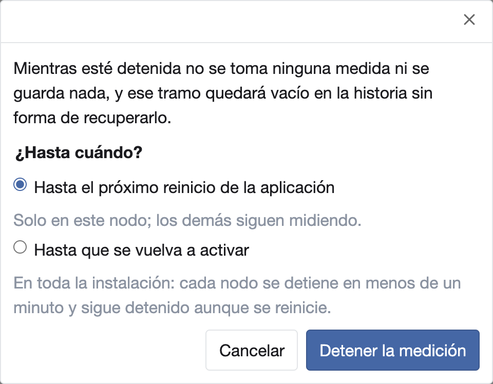
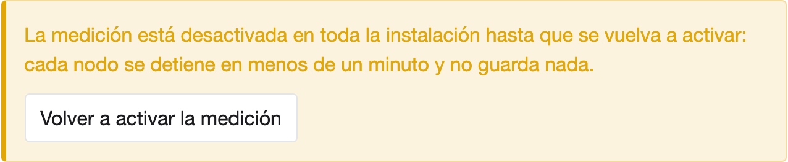

# Detener y reanudar la medición

Puedes detener la medición en el nodo que te sirve la página hasta su próximo reinicio, o en toda la instalación hasta
que la vuelvas a activar. Mientras está detenida no se toma ninguna medida ni se guarda nada, y ese tramo queda vacío
en la historia para siempre.

Solo puede detenerla quien tiene el permiso que cambia la política ([Antes de empezar](index.md#antes-de-empezar)).

## Detener la medición

1. Abre **Métricas**. En el **Estado**, en la fila de **Este nodo**, pulsa **Detener la medición**.
2. En **¿Hasta cuándo?**, elige el alcance. **Hasta el próximo reinicio de la aplicación** la detiene solo en este
   nodo, y los demás siguen midiendo. **Hasta que se vuelva a activar** la detiene en toda la instalación, también en
   los nodos que se reinicien.

    { width="480" }

3. Pulsa **Detener la medición**.

Con la primera opción, el nodo deja de medir en el momento. Arriba de cada página de métricas sale un aviso con el
nombre del nodo, la hora y quién la detuvo, por ejemplo «La medición de este nodo (…) está en pausa desde las 10:30,
por admin, hasta el próximo reinicio. Mientras tanto no se toma ninguna medida en él ni se guarda nada.».

Con la segunda, sale este aviso en todas las páginas de métricas:

{ width="638" }

Cada nodo deja de medir la próxima vez que relee su configuración, en menos de un minuto. Hasta entonces, la columna
**Medición** de tu nodo sigue diciendo «Cada 30 s», y después pasa a «Desactivada».

Los demás nodos tardan más en reflejarlo en el **Estado**. Cada uno deja de medir al releer su configuración, y su fila
sigue diciendo «Mide» entre cinco y seis minutos más, porque la página solo sabe de ellos lo que anotan al medir.
Después dice «Sin medir desde las» y la hora en que acaba el último minuto que anotaron. Que un nodo diga «Mide» justo
después de desactivar no quiere decir que la orden no le haya llegado. Lo mismo ocurre con la pausa de otro nodo, que
nunca sale como «En pausa».

### Si la segunda opción sale atenuada

Una instalación se puede configurar para que tome de su configuración de arranque si la medición está activa. En ese
caso la aplicación no puede desactivarla, y la opción sale atenuada con el motivo «No disponible: en esta instalación
la medición no se desactiva desde la aplicación.». Puedes detener la medición de este nodo con la primera opción. Para
desactivarla en toda la instalación, quien administra los servidores cambia esa configuración y reinicia la
aplicación.

## Reanudar la medición

- Si está en pausa, pulsa **Reanudar la medición** en el aviso. El nodo vuelve a medir en el momento. Reiniciar el
  nodo también la reanuda.
- Si está desactivada, pulsa **Volver a activar la medición** en el aviso. Cada nodo empieza a medir en menos de un
  minuto, sin reiniciar. Mientras tanto, tu nodo sale como «Apagada» en el **Estado** y la página dice «Esta
  instalación no está midiendo», con lo que se puede hacer para activarla. Pulsa **Actualizar** pasado ese tiempo.
