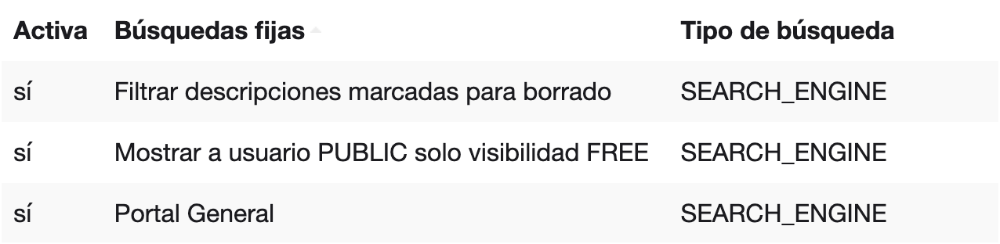
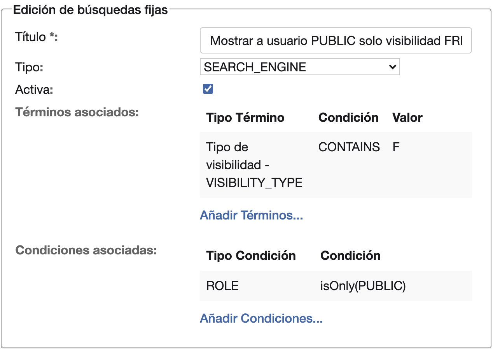

# Publicar una descripción en el OPAC

Quien consulta el OPAC sin entrar con una cuenta solo ve las descripciones con visibilidad **Acceso Libre**. Las
descripciones nuevas se crean como **Privado**. El formulario no muestra la visibilidad hasta que un administrador lo
activa.

## Qué ve el público

Cada descripción tiene una de estas visibilidades:

- **Acceso Libre**: sale en el OPAC.
- **Archivo** y **Privado**: no salen en el OPAC. Las ve el personal del archivo, que entra con su cuenta.

Lo decide la búsqueda fija «Mostrar a usuario PUBLIC solo visibilidad FREE». La encuentras en **Administración**,
apartado **General**, **Búsquedas fijas**.

{ width="638" }

PUBLIC es el rol de quien consulta el OPAC sin cuenta. En esa búsqueda fija, el término **Tipo de visibilidad -
VISIBILITY_TYPE** con el valor F deja pasar solo **Acceso Libre**, y la condición **ROLE** la aplica solo a ese rol.

{ width="634" }

Otra búsqueda fija, «Filtrar descripciones marcadas para borrado», oculta además las descripciones en estado
**Eliminada**, aunque sean de **Acceso Libre**.

!!! warning "Si desactivas la búsqueda fija"
    Si quitas la marca de **Activa** de «Mostrar a usuario PUBLIC solo visibilidad FREE», o si eliminas la búsqueda
    fija, el público ve todas las descripciones, también las de **Privado**.

## Mostrar el campo Visibilidad en el formulario

Lo hace una vez un administrador, y vale para todos los formularios de descripción.

1. En **Administración**, apartado **Sistema**, pulsa **Variables de configuración**.
2. Pulsa **Añadir ...** y crea la variable `desar.web.forms.hidedescriptionstate` con el valor `false`.

El formulario muestra **Visibilidad** desde ese momento, sin reiniciar la aplicación. El nombre de esta variable y su
descripción en la pantalla hablan del estado de la descripción, pero es la que muestra la visibilidad. La otra,
`desar.web.forms.hidevisibility`, hace lo mismo con el campo **Estado de la descripción**.

Para volver a ocultar el campo, elimina la variable.

## Publicar una descripción

1. Abre la descripción: **Nueva descripción** para una nueva, o el icono **Editar la descripción** de su fila en los
   resultados de una búsqueda. El icono aparece al pasar el puntero por la fila.
2. En **Visibilidad**, elige **Acceso Libre** y pulsa **Guardar**.

La descripción sale en el OPAC en cuanto la guardas. Para retirarla, cambia su visibilidad a **Archivo** o
**Privado**.

## Lo que se puede personalizar

nubarchiva se puede configurar para:

- Publicar según un campo del formulario, como una casilla. Una búsqueda fija sobre ese campo deja ver al público solo
  las descripciones que lo tienen marcado.
- Filtrar según el canal por el que llega la consulta, como el OPAC o la recolección de metadatos por OAI-PMH. Cada
  canal tiene entonces su búsqueda fija, con una condición **CHANNEL**.
