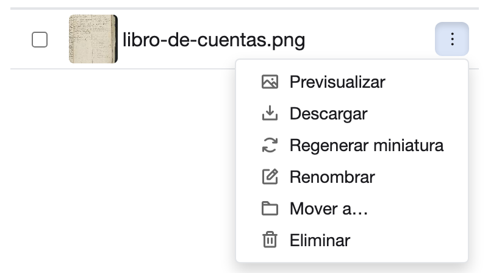

# Regenerar la miniatura de un fichero

Desde el gestor de digitalizaciones puedes rehacer la miniatura de un fichero con la configuración que tiene la
aplicación en ese momento, o generar la que le falta. La miniatura nueva aparece en la lista y en el panel de detalles
sin que tengas que recargar la página. Lo mismo pasa cuando cambia porque subes un fichero con el mismo nombre y
otra extensión, o porque la asignas a mano.

Si quieres hacerlo con todas las digitalizaciones a la vez, usa [Regenerar las miniaturas](regenerate-thumbnails.md).
Allí se explica también qué ficheros tienen miniatura.

## Regenerar la miniatura

1. En **Administración**, apartado **Descripciones de Archivo**, pulsa **Gestión de digitalizaciones** y ve a la carpeta
   del fichero.
2. Pulsa **Más acciones** (⋮) en la fila del fichero y, en el menú, **Regenerar miniatura**. El menú es el mismo en la
   vista de mosaico y en el panel de detalles, que se abre al pulsar el fichero.

    { width="400" }

Un aviso te dice lo que ha pasado, por ejemplo «Se ha regenerado la miniatura de «libro-de-cuentas.png».». Si el
fichero no tenía miniatura, dice que se ha generado.

{ width="420" }

Si la miniatura tarda en hacerse, el aviso sale cuando está lista, si sigues en el gestor y no pasa más de media hora.

Si el almacén de digitalizaciones de la instalación es de solo lectura, el menú no ofrece **Regenerar miniatura**.

## Las miniaturas que no cambian

La aplicación no toca estas dos miniaturas, y el aviso dice por qué:

- La que se asignó a mano. Si quieres que siga la configuración actual, asígnala otra vez a mano.
- La que reconoce como hecha con otro programa, por ejemplo una copiada al almacén. No las reconoce todas, y la que no
  reconoce se rehace como las demás. Si quieres sustituirla, asígnala a mano.

## Si no se puede generar

Si el fichero está dañado y ya tenía miniatura, se conserva la anterior. Si no la tenía, sigue con el icono de su
tipo. En los dos casos el aviso dice el problema y qué hacer. Si por ejemplo un PDF no se puede leer, te pide que lo
abras para comprobarlo y, si está dañado, que lo sustituyas por una copia correcta.

## En el catálogo público

El catálogo público puede seguir mostrando la miniatura anterior, porque el navegador guarda la que ya había
descargado. Recarga la página sin la caché del navegador, con **Ctrl+F5** o, en un Mac, **Cmd+Mayús+R**.
