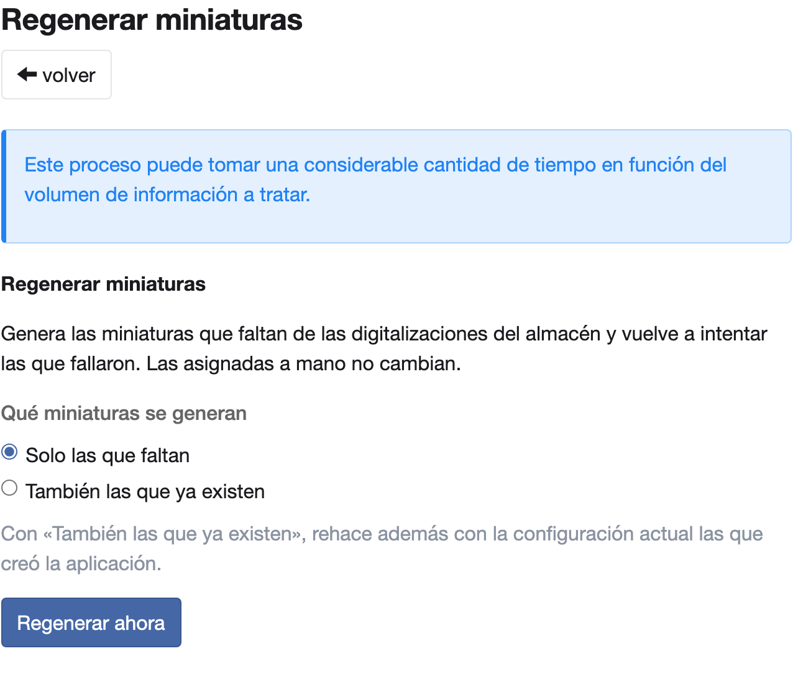
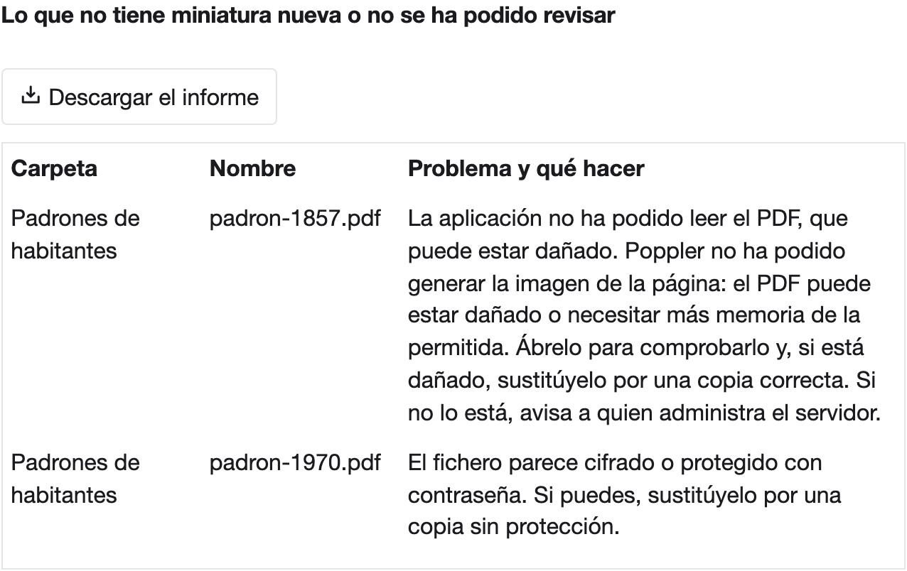

# Regenerar las miniaturas

Con **Regenerar miniaturas** generas de una vez las miniaturas que faltan de las digitalizaciones del almacén, también
las que no se pudieron generar al subirlas. Sirve, por ejemplo, para que los PDF subidos antes de que la aplicación
generara su miniatura dejen de mostrar el icono de su tipo. Si eliges **También las que ya existen**, rehaces además las
que ya hay, por ejemplo para que tengan el tamaño o la calidad que ha configurado quien administra la instalación.

## Qué ficheros tienen miniatura

La aplicación genera la miniatura de las imágenes que sabe leer, como JPEG y PNG, la de los PDF, a partir de su
primera página, y la de los vídeos MP4, a partir de uno de sus fotogramas. Para los MP4 hace falta que la instalación
tenga el programa `ffmpeg`, del que se encarga quien administra el servidor. Los demás ficheros se muestran con el icono
de su tipo.

Algunos PDF no tienen miniatura, o les falta parte de ella, salvo que la instalación tenga también el programa Poppler. Son,
por ejemplo, los que llevan una imagen muy grande o imágenes JPEG 2000. Los PDF cifrados, por ejemplo los que piden contraseña
o restringen la copia o la impresión, nunca la tienen.

Quien administra la instalación puede elegir otra página de los PDF u otro momento de los vídeos, o que los de un tipo no
tengan miniatura. El cambio vale para las miniaturas que se generen desde entonces.

Los ficheros de la misma carpeta que se llaman igual salvo la extensión comparten miniatura. Si uno es una imagen, se
genera desde ella. Si ninguno lo es, como un PDF y un vídeo, se queda la del que subiste primero, salvo que de ese no se
haya podido generar.

Un fichero del que no se puede generar la miniatura, como un PDF dañado o cifrado o un MP4 sin `ffmpeg`, sigue con el icono
de su tipo, y la regeneración lo vuelve a intentar cada vez que la lanzas.

## Qué miniaturas cambian

Con **Solo las que faltan**, la opción que viene marcada, la regeneración no cambia ninguna miniatura que ya existe.

Con **También las que ya existen**, rehace las que generó la aplicación con la configuración que tiene en ese momento. Si
no puede rehacer una, se queda la que había. Nunca cambia estas dos:

- La que se asignó a mano. Si quieres que siga la configuración actual, asígnala otra vez a mano.
- La que reconoce como hecha con otro programa, por ejemplo una copiada al almacén. No las reconoce todas: la que no
  reconoce se rehace como las demás. Si quieres sustituirla, asígnala a mano.

Si después el catálogo público o el gestor siguen mostrando la miniatura anterior, es que el navegador guarda la que ya
había descargado. Recarga la página sin la caché del navegador, con **Ctrl+F5** o, en un Mac, **Cmd+Mayús+R**.

## Lanzar la regeneración

1. Abre **Administración** y, en el apartado **Descripciones de Archivo**, **Regenerar miniaturas**.

    { width="638" }

2. En **Qué miniaturas se generan**, deja **Solo las que faltan** o elige **También las que ya existen**.
3. Pulsa **Regenerar ahora** y, en **Se iniciará el proceso**, pulsa **Aceptar**.

La página muestra el avance y, al terminar, el resultado, por ejemplo «Miniaturas generadas: 2. No se han podido generar: 0.
Ya existían: 15.». Con **También las que ya existen**, dice además cuántas ha rehecho, cuántas no ha podido rehacer y cuántas
no ha tocado. El trabajo queda también en **Tareas de larga duración**, como **Regenerar miniaturas**.

Si alguna carpeta del almacén no se ha podido abrir, la regeneración sigue con las demás y el resultado dice cuántas son. Sus
digitalizaciones no se han revisado: avisa a quien administra el servidor.

Si dentro de una carpeta hay algo que no se puede abrir, como un enlace a un fichero que ya no existe o un enlace que lleva a
sí mismo, a la carpeta donde está o a una que la contiene, la regeneración revisa el resto de esa carpeta. El resultado dice cuántos son, y la lista de abajo y el informe los
nombran con su carpeta y el motivo. Pide a quien administra el servidor que los revise.

Si el almacén de digitalizaciones de la instalación es de solo lectura, la página lo avisa y no ofrece el botón.

## Detenerla y seguir después

Mientras la regeneración está en marcha, la página ofrece **Detener**. Al pulsarlo, se para antes de la siguiente
digitalización; lo que ya ha hecho se conserva. El resultado dice que se ha detenido y cuántas digitalizaciones ha
revisado.

La regeneración también se detiene sola si el servidor se queda sin el espacio libre que necesita para seguir trabajando.
El resultado lo dice: avisa a quien administra el servidor y, cuando haya espacio, vuelve a lanzarla.

Para seguir una regeneración detenida sin repetir lo que hizo, vuelve a la página: ya tiene elegida la misma opción y,
con **También las que ya existen**, en **Rehacer solo las generadas antes de**, la fecha desde la que no hay que rehacer:
la de comienzo de la detenida o, si esta ya seguía a otra, la misma fecha que usó. Con esa fecha solo se rehacen las miniaturas escritas antes de ella, y el resultado dice cuántas no ha rehecho por ser
posteriores. La fecha y la hora son las del servidor. Si la aplicación se ha parado entretanto, la página ya no la
propone: escríbela tú. Si dejas la fecha vacía, se rehacen todas.

## Ver qué ficheros no tienen miniatura

Si alguna no se ha podido generar, debajo del resultado salen los ficheros, cada uno con su carpeta, el problema y qué
hacer. Con **También las que ya existen** salen además las que no se han podido rehacer y las que no se han tocado, por
haberse asignado a mano o no haberlas generado la aplicación. Si por ejemplo un PDF está dañado, te pide que lo abras y lo sustituyas por una copia correcta, y si falta un
programa en el servidor, te dice cuál hay que instalar.

{ width="638" }

La página muestra los cien primeros. Con **Descargar el informe** los tienes todos en un fichero CSV, que se abre con una
hoja de cálculo. En el fichero, una celda que empieza por «=», «+», «-» o «@» lleva un apóstrofo delante, para que la hoja
de cálculo no la tome por una fórmula. Si pasan de cien mil, el informe guarda los primeros y la página lo avisa.

De los ficheros que comparten miniatura sale uno solo, el que tiene preferencia para generarla. El resultado y el informe
son los de la última regeneración, y se pierden al parar la aplicación. Para verlos otra vez, vuelve a lanzarla.

## En una instalación con instituciones

La regeneración se ejecuta en la institución en la que estás. Si tienes el rol de administrador en varias, puedes
lanzarla en todas a la vez. Añade `?tenant=*` a la dirección de la página, comprueba la lista de instituciones que
muestra y lánzala como arriba.

La página solo muestra las cifras y los ficheros de la institución en la que estás, aunque la hayas lanzado en todas. Para
ver los de cada una, entra en ella y abre la misma página.

**Detener** detiene solo la regeneración de la institución en la que estás; las de las demás siguen.
